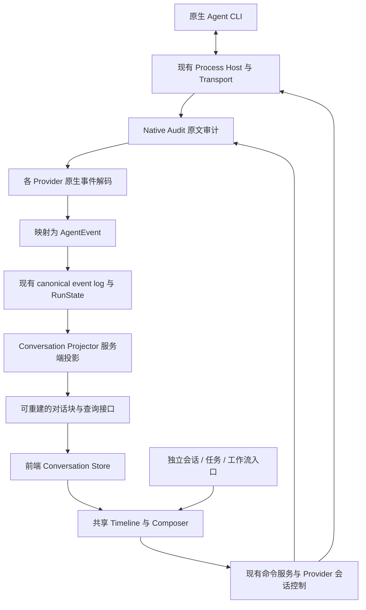
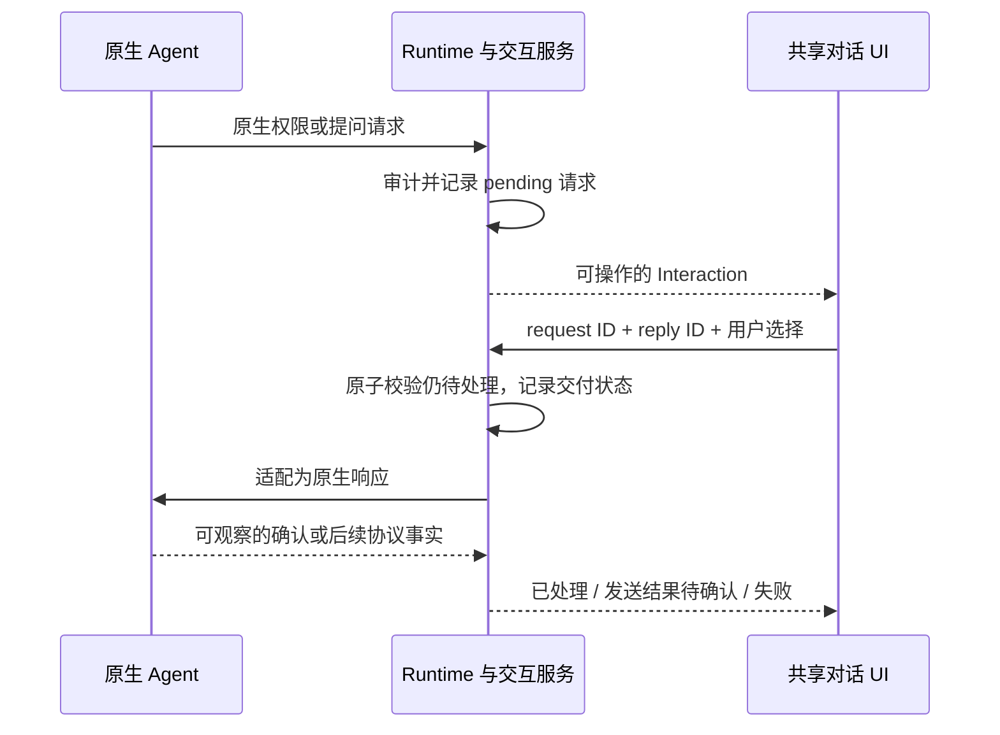

## 1. 这次要改成什么

状态：**已实施，验证范围及边界见第 16 节**。研究日期：2026-10-20；实施记录日期：2026-10-21。

Vibe Studio 的独立会话、任务会话、工作流节点会话，使用同一套对话内核。各家适配器理解自己的协议，服务端把事件整理成可恢复的对话内容，前端负责展示与用户操作。换一种业务入口，不再换一套消息解析和历史加载逻辑。

用户应当能够看清：智能体说了什么、正在思考还是调用工具、工具做了什么、哪些操作需要回应，以及本次实际使用的模型和思考设置。刷新、重连、切换页面之后，这些内容和状态应当一致。

本设计沿用 [Agent Runtime 底座](../agent-runtime/README.md)，重点补齐从原生输出到共享对话界面的这一段。它不重建进程管理器、工作流调度器、CommandAdapter 或 ToolManager，也不让平台接管原生工具执行。

### 已有边界与本次建议

| 类别               | 内容                                                                                                                             |
| ------------------ | -------------------------------------------------------------------------------------------------------------------------------- |
| 延续已确认边界     | 建好的会话绑定智能体；原生工具仍由智能体执行；原生输入输出与统一事件分别留存；不设置运行或空闲时限；不静默更换会话或模拟原生能力 |
| 本次架构建议       | 服务端统一生成对话内容块；明确增量、快照、局部更新；前端不再猜协议；实时和历史共用投影规则                                       |
| 本次交互建议       | 共享正文、工具详情、思考区域、输入区、审批与提问区域；按需显示，减少常驻信息                                                     |
| 尚未定稿的视觉细节 | 浮框宽度、具体间距、配色比例、展开动画；沿用现有对话承载方式讨论，不把本文当作已确认的新外壳原型                                 |
| 不在本次范围       | 新增工具执行网关、多租户体系、知识库、原生历史全量迁移、自动清理审计数据、重画工作流业务模型                                     |

## 2. 当前代码已经有什么，缺在哪里

以下是重构前的工作区源码走读结论，包含当时尚未提交的修改；不是对已发布 npm 版本的结论，也不是六家 CLI 实测报告。重构后的落地情况见文末实施记录。

| 环节       | 已有能力                                                    | 本次需要处理的问题                                                                                                  |
| ---------- | ----------------------------------------------------------- | ------------------------------------------------------------------------------------------------------------------- |
| 运行底座   | Session、AgentRun、Turn、RunAttempt、进程宿主、控制命令     | 复用这些身份与生命周期，不在聊天组件再建一套运行状态机                                                              |
| 原生协议   | 六家真实 CLI 接入，ACP 有公共传输实现                       | 公共事件分类器承担了过多厂商协议解码，部分内容丢失或落入 extension                                                  |
| 统一事件   | `AgentEventEnvelope` 有运行身份、序号和原生审计引用         | 正文缺少明确的更新方式，Thinking 缺少块身份，工具详情不够丰富                                                       |
| 持久化     | canonical event 与 RunState 已有事务写入                    | 增加可重建的对话读模型，保留事件事实源                                                                              |
| 推送与恢复 | AgentRun WebSocket 已支持游标回放、先订阅再补历史、周期补读 | 扩展到有界的会话视图；不能把现有回放能力当作不存在而重写                                                            |
| 对话投影   | 前端从 canonical event 生成可展示记录                       | 文本通过 `startsWith` 猜增量或全文；Thinking 按事件分行；工具主要落到通用类型；extension 未形成可用展示             |
| 交互请求   | 有 approval/input 事件与控制类型；ACP 已有真实原生权限控制通道 | Codex/Claude 的 direct 路径仍有 Noop 注入缺口，需要保留原生请求并接通回答；不能据此把 ACP 也判断成只有空实现 |
| 旧日志解析 | 部分厂商旧 normalizer 能解析更丰富内容                      | 普通会话走 canonical 链路，旧解析器并非自动兜底；应迁入正确规则，不保留两条聊天事实源                               |

源码入口见[附录 A](#附录-a本项目源码入口)。

## 3. 六家智能体：统一什么，保留什么

下表描述本项目当前接入方式。启动命令只列协议相关部分，省略配置、权限和会话参数；不能当作完整安装或启动教程。

| 智能体           | 接入方式                                             | 需要理解的原生输出                                                                | 模型与思考设置边界                                                                                       |
| ---------------- | ---------------------------------------------------- | --------------------------------------------------------------------------------- | -------------------------------------------------------------------------------------------------------- |
| Codex            | `codex app-server`，stdio JSON-RPC                   | thread/turn/item 生命周期、文本及 reasoning 增量、命令、文件、MCP、服务端交互请求 | 读取本机目录与当前会话能力；effort 按所选模型和实际 CLI 返回值处理                                       |
| Claude Code      | `claude -p`，双向 stream-json，包含 partial messages | 外层消息与嵌套 `stream_event`、content block、thinking、tool use/result、控制请求 | 保留模型 ID 与别名区别；`--effort` 等参数按本机探测结果开放                                              |
| Gemini           | `gemini --acp`，stdio ACP                            | message/thought chunk、tool call/update、plan、权限请求、配置事件                 | 模型来自 ACP 能力；当前适配器不支持每次尝试覆盖 reasoning，不能显示一个实际上无效的通用档位              |
| Oh My Pi         | `omp --mode rpc`，原生 NDJSON RPC                    | message update、assistant message event、thinking delta、工具执行事件、RPC 响应   | 模型切换后读取 `get_available_thinking_levels`，设置后核对实际 state；本项目接的是 OMP，不是任意 Pi 实现 |
| OpenCode         | `opencode acp`，stdio ACP                            | ACP 公共内容及 OpenCode 配置差异                                                  | 解析当前 catalog 与 `effort` 配置项，不套用 Codex 的枚举                                                 |
| DeepSeek Harness | `dsh --profile acp`，stdio ACP                       | ACP 内容与该实现实际提供的 thought/tool/config 事件                               | 保留 `reasoning_effort` 语义；协议支持 thought 不代表必定逐 token 返回                                   |

公共层统一的是“文本、思考、工具、计划、交互、状态”的语义，不统一各家的 JSON 字段和控制方法。

- Gemini、OpenCode、DSH 共用 ACP framing、请求关联和公共事件解码，各自保留配置与能力差异。
- Claude、Codex、OMP 各自解码原生协议，不靠全局递归搜索 `text`、`content`、`status` 猜消息含义。
- 思考等级是输入配置；思考内容是原生输出。设置了高等级，也可能只有摘要，或完全没有可展示内容。
- 原生工具的名称、输入输出、MCP 服务名、文件位置等信息应保留。共同分类只用于选择展示组件。
- CLI 版本、协议库版本、模型版本分别记录。当前代码中的 Codex 协议依赖、ACP crate 版本不等于用户机器上的 CLI 版本。

## 4. 四个参考项目的取舍

研究基于本地缓存快照，未拉取或运行上游最新版本。固定提交与代码链接见[附录 B](#附录-b参考源码与研究范围)。

| 项目                | 值得采用的设计                                                                              | 不直接照搬的部分                                                                        | 对本项目的影响                                                 |
| ------------------- | ------------------------------------------------------------------------------------------- | --------------------------------------------------------------------------------------- | -------------------------------------------------------------- |
| **Paseo，主要参考** | Client 与 Session 分工；结构化工具详情；工具生命周期投影；历史补齐；相邻流片段合并          | 移动端、daemon、多设备交付的全部结构；不能只因接口声明就认定每家已支持                  | 分开配置发现与会话控制；统一对话块；恢复有游标，历史有完整基线 |
| **MindFS**          | 协议运行时分组；工具 kind/content/locations；按 callId 更新且保留省略字段；终态不退回运行中 | 内容哈希作为部分 timeline ID；庞大根组件承载合并逻辑；同会话换 Agent 的边界             | 工具更新规则显式化；身份不能随文本变化；合并逻辑离开 UI 组件   |
| **Multica**         | 执行入口窄；输出通道与最终结果分开；各 provider 有自己的实现                                | task message 传递中丢失 CallID；工具输出截到固定长度；文本与思考分缓冲；固定 500ms 刷新 | 保留工具关联键与交错顺序；预览可以短，事实不能因 UI 需要被截断 |
| **QM**              | Harness profile；工具活动关联；历史窗口；稳定 Markdown 段和活动尾部缓存                     | 平台拥有工具执行、上下文策略的整体方案；其 Pi 内嵌 SDK 的数据模型；无 ID 时靠相邻行配对 | 采用局部重绘与有界加载；保留原生执行权；工具无法关联时明确未知 |

几个容易误读的地方：MindFS 的工具映射也并非完全无损；Multica 的 500ms 是源码策略，不是本次测得的卡顿结论；QM 的历史缩短是读取投影，不能据此截断本项目原始审计；Paseo 的合并实现不能替代我们对 patch 与 snapshot 的明确约定。

## 5. 组件划分与职责

图中的原文审计是接收和发送的先行记录，不要求每条实时输出都重新从磁盘读取。canonical 投影失败可以补做；原生审计失败沿用底座既有处理规则，不能悄悄漏记后继续。

| 组件职责                | 负责                                               | 不负责                                     |
| ----------------------- | -------------------------------------------------- | ------------------------------------------ |
| Provider 配置发现       | 本机版本、模型目录、支持的设置、配置来源           | 用硬编码模型列表冒充本机结果               |
| Provider 会话控制       | 创建、续接、发送、取消、批准、回答的原生调用       | 项目、任务、工作流业务调度                 |
| Provider 事件解码与映射 | 原生边界、ID、更新语义、工具详情、原生扩展         | React 布局、折叠状态                       |
| Conversation Projector  | 顺序、内容合并、工具关联、交互状态、可重放的内容块 | 执行工具、替代 RunState 判定进程状态       |
| 对话查询与推送          | 最近内容、向前分页、变更补齐、详情读取             | 再写一套文本合并规则                       |
| 前端 Conversation Store | 按 ID/revision 接收服务端结果，管理订阅和局部缓存  | 解码原生协议、猜测 delta、推断工具是否成功 |
| 共享 UI                 | 正文、工具、思考、交互请求、输入框、滚动与折叠     | 存储另一份会话历史                         |
| 业务宿主                | 决定打开哪个 Session，提供任务/项目/Node 上下文    | 私有聊天协议或专属消息列表                 |

以上是职责划分，不要求新增同名的大接口。优先拆分现有 `provider_adapter.rs`，复用已有传输、配置、命令与审批抽象，避免创建一个什么都能做的巨型 Adapter。

## 6. 对话数据模型

### 6.1 三类数据各有用途

| 数据                    | 作用                                     | 是否可以从别处重建                                                     |
| ----------------------- | ---------------------------------------- | ---------------------------------------------------------------------- |
| Native Audit            | 留存真实输入、输出和协议帧，定位适配错误 | 不能拿 UI 内容反向伪造；独立保存                                       |
| canonical event log     | 平台接受的语义事实，包含原生来源引用     | 用固定映射规则可修复尚未成功投影的原始记录；已提交事件不被 UI 原地改写 |
| Conversation read model | 面向聊天展示的块、索引、详情与进度       | 从 canonical 事件重建；不是第三份独立维护的业务事实                    |

对话 projector 在服务端实现一次。实时事件和历史事件进入同一个 reducer。前端只应用服务端给出的内容块快照，或有明确基线的传输补丁，不再实现一份工具与思考语义合并器。

建议复用 SQLite，增加对话投影的块索引、必要的正文分片和处理检查点。它们是内部读模型，不增加外部存储服务，也不建设通用事件中台。

### 6.2 身份与顺序

| 身份                                      | 含义与规则                                                                     |
| ----------------------------------------- | ------------------------------------------------------------------------------ |
| `session_id`                              | 平台会话，固定绑定 provider 与运行身份                                         |
| `agent_run_id / turn_id / run_attempt_id` | 沿用现有底座。后续发言可以产生新的 run；一次 run 的重试产生新的 attempt        |
| `event_id`                                | 事件身份，用于幂等；同 ID 不同内容是冲突，不能当重复忽略                       |
| `block_id`                                | 展示内容身份。正文增长、工具完成、展开折叠都不改变它                           |
| `provider_item_id / provider_call_id`     | 保留原生关联，不作为跨运行的全局唯一 ID                                        |
| `parent_block_id`                         | 有原生证据时关联父工具或 native subagent；不凭时间接近推断                     |
| `source_refs`                             | 对应事件和原生帧的位置；使用范围或引用，避免每条 UI 更新复制不断增长的 ID 数组 |
| `revision`                                | 投影中的块版本，用于覆盖旧快照；不同于原生序号或模型 token 数                  |

优先用“attempt + 原生 message/item/call ID + 内容块索引”派生稳定身份。协议没有 ID 时，适配器用明确的块开始边界和对应审计帧序号分配身份；可重放得到相同结果。禁止使用文字哈希、当前时间或每次 render 新建 UUID。

原生工具 ID 可能在重试后重复，必须按 attempt 隔离。协议明确证明续接的是同一原生活动时，才添加 continuation 关联，不据此合并两次实际执行。

适配器需要的开放消息、块索引、调用关联也属于可恢复状态。解析检查点必须记录映射版本及必要状态，或能从之前的审计边界重放恢复；不能从流中间重新开始解析，再给同一块分配另一个 ID。原生重发没有可用身份时，不能按文字相同认定重复，需保留这项协议限制。

沿用当前会话的稳定 run 排序键 `(created_at, agent_run_id)`，run 内按 attempt 与 canonical sequence 排序。它提供确定的显示顺序，不宣称能推断并行 run 的真实因果关系。对话块占用第一次出现的位置，工具结果回来后更新原位。原生 frame 派生多个事件时使用确定的子序号，避免事件 ID 冲突。

AgentRun 的 `(attempt_number, sequence)` **只在该 run 内有效**。会话包含多个 run，不能直接拿这个二元组充当整个会话的全局游标。

### 6.3 内容块种类

| 种类                 | 主要字段或内容                                               | 默认呈现                                                      |
| -------------------- | ------------------------------------------------------------ | ------------------------------------------------------------- |
| Text                 | role、文本/资源片段、原生 message 关联、是否结束             | 正常对话正文，支持 Markdown                                   |
| Reasoning            | 内容、`summary / exposed_text / unknown` 来源类别、是否结束  | 紧凑折叠区；只展示原生返回的内容                              |
| Tool                 | 原始工具名、call ID、kind、输入输出、状态、位置、父子关系    | 一行摘要，展开后使用对应详情组件                              |
| Plan                 | plan ID、条目及状态                                          | 同一个计划区域更新，保留来源；不冒充平台工作流                |
| Interaction          | permission/question、请求 ID、选项、字段、作用范围、交付状态 | 需要用户操作时出现在输入框上方，历史保留处理结果              |
| Notice / Error       | 发生阶段、可读说明、原生来源、是否影响本次执行               | 区分配置失败、连接中断、工具错误和整个运行失败                |
| Resource / Extension | 资源引用或 provider namespace、类型、结构化内容              | 可识别内容用专门组件；未知内容保留可展开摘要，不塞成整屏 JSON |

Token usage、有效模型、运行状态是有来源的元数据，不必每次更新都占一行聊天消息。能力目录等内部协议通知进入相应元数据；不能因为保留了 extension 就把所有内部通知都展示给用户。

### 6.4 增量、快照、局部更新必须分开

以下操作名称是契约提案，最终 Rust 类型可调整，但含义不能混用。

| 更新语义   | 处理规则                                | 常见来源                               |
| ---------- | --------------------------------------- | -------------------------------------- |
| `append`   | 只追加到指定块/字段，事件去重后执行一次 | 文本 delta、thinking delta、命令输出流 |
| `snapshot` | 以本次完整值替换指定块或指定字段        | 原生最终 message、完整工具结果         |
| `patch`    | 只更新明确给出的字段                    | ACP tool update、计划状态变更          |
| `finish`   | 结束该块，并记录结束原因                | content block stop、工具终态           |

必须明确 snapshot 的作用域。例如“输出字段的完整快照”不能顺便清空该工具的输入和名字。

patch 中“没有字段”表示保持原值；`null` 只有在该字段契约明确允许清除时才表示清除。嵌套对象默认整体替换该字段；确需局部合并时由明确的字段操作描述，不能随意深合并 JSON。数组同样不能擅自拼接。

最终回答与已输出的增量有原生关联时，替换/结束原块，不再追加第二份全文。没有可靠关联时不按文本相似度偷偷去重；保留来源并修复适配器，避免把两次相同回答误删。

同一原生消息包含文字、工具和后续文字时，保留内容块顺序。协议没有细分 ID 时按交错边界形成稳定片段，不把工具之后的话追加到工具之前的段落末尾。

## 7. 工具调用与思考：展示丰富，但不伪造

### 工具分类与详情

| 语义类别            | 详情重点                                                       |
| ------------------- | -------------------------------------------------------------- |
| Shell               | 实际命令、工作目录、stdout/stderr（若可区分）、退出码          |
| Read / Write / Edit | 文件路径、范围、操作类型、原生提供的内容；有 diff 才显示 diff  |
| Search / Fetch      | 查询词、目标路径或 URL、结果摘要与完整结果入口                 |
| MCP                 | 服务名、工具名、参数和结果；不把所有 MCP 工具只命名为“MCP”     |
| Native subagent     | 原生任务标题、子调用关系、原生状态；与平台 workflow Node 区分  |
| Other               | 真实工具名、输入输出和状态，即使暂时没有专属 renderer 也能查看 |

优先依据协议字段与明确映射分类，不在 React 里通过标题包含“read”“search”猜类型。单个工具可能涉及多个文件，不能只留第一个路径。

### 生命周期的处理规则

- 工具 start、progress、result 更新同一块。并行两个相同名称的工具仍是两个块。
- `completed/failed/cancelled/denied` 分别保留。批准只是允许执行，不能显示成“执行成功”。
- 终态之后的旧 running 更新不能把它重新变成运行中；允许迟到的输出补充详情。相互冲突的终态保留来源并报告异常，不随意选一个覆盖。
- 只有 result、没有 start：根据可靠 call ID 建块，标记缺少开始信息，允许之后补齐。不伪造开始时间和耗时。
- 没有 call ID、协议也没有顺序关联保证：保留未关联记录，不能拿“附近最近的工具”配对。
- 工具参数 JSON 尚未接收完整时，保存原始片段并显示“参数接收中”；JSON 解析失败不应让整条消息消失。
- 父工具晚到时，保留孩子原始顺序并补上关联；孤儿、循环引用和未知父节点采用平铺兜底，避免无限递归或隐藏消息。
- 运行被取消但某个工具没有返回结果时，显示“结果未确认”，不把所有未完成工具批量伪造成原生 cancelled。
- 收到取消命令、原生确认取消、进程结束是不同事实。继续复用底座取消流程，UI 不能单凭点击就把 RunState 写成 cancelled。

### 思考的处理规则

同一 reasoning block 的片段持续更新，不能每个 token 新增一行。遇到工具或新的原生块时保留边界，不把所有思考跨阶段揉成一大段。

如果原生只给摘要就标为摘要；没有内容时可以展示“正在处理”的运行状态，但不生成思考文字。原生加密或不可展示的字段只保留原始记录，不当作自然语言输出。

### 一个可检查的流转例子

| 到达顺序 | 原生事实                     | 对话变化                               |
| -------- | ---------------------------- | -------------------------------------- |
| 1        | 文本块开始：“我先运行测试”   | 新建正文块 A                           |
| 2        | 工具 C 开始，命令 `npm test` | 新建工具块 C，显示运行中               |
| 3        | C 输出第一段日志             | 更新 C，不新建一条工具消息             |
| 4        | C 局部更新，只有 status      | 保留命令和前面日志                     |
| 5        | C 返回退出码 0               | C 显示成功，完整输出仍可查看           |
| 6        | 新正文：“测试通过”           | 新建正文块 B，放在 C 后面              |
| 7        | 重连重复收到步骤 3–6         | 无重复文字、工具或回答                 |
| 8        | 刷新页面                     | 仍为 A、C、B；C 的状态、输入、输出一致 |

## 8. 实时输出、历史与重连使用同一份结果

### 8.1 服务端投影与检查点

canonical event + RunState 继续沿用现有事务。对话 projector 消费已提交事件，在另一个短事务中同时写入改变的块、正文分片、已处理的 run 游标和会话投影 revision，然后才通知客户端。

这样对话投影失败不会阻断已经成功记录的 Agent 事实；重启后从检查点继续。检查点不能领先于块内容，重复消费同一事件不能重复追加文本。运行状态已更新而对话尚未追上时，返回明确的同步进度，不假装尾部已经完整。

每个会话串行提交投影变更，分配仅用于展示同步的递增 revision；后端保存各 run 的源游标。前端无需维护一组原生协议游标。完整重建投影时更换 `projection_epoch`，旧客户端重新取基线；日常进程重启不更换 epoch。

这不是新增一套执行事件总线。原始事件仍在现有 event log；revision 只是可重建读模型的版本。

### 8.2 首屏、翻页、补齐

| 场景                      | 处理方式                                                                                                             |
| ------------------------- | -------------------------------------------------------------------------------------------------------------------- |
| 首次打开                  | 返回最近一页完整内容块、运行摘要、未解决交互，以及同一读取快照的 epoch/revision；不用从第一个 token 开始向浏览器回放 |
| 向上翻历史                | 按块的固定位置向前分页；每块带自身 revision，与本地较新版本合并，不能覆盖新状态                                      |
| 页面打开期间更新          | 订阅会话投影变化，按 block ID 更新；推送遗漏通过已提交 revision 补读                                                 |
| 已有游标后重连            | 从本地已完整接收的 revision 补齐，持续读到 `has_more=false`；不能只拿最新一页而跳过中间内容                          |
| 没有可用游标/epoch 已变化 | 明确重取首屏基线，保留草稿等本地交互状态                                                                             |
| 旧工具仍运行但已不在尾页  | 运行摘要与待处理交互仍能定位它；更新携带完整基线或可获取的块引用，不只给一个无法解释的 status                        |

“完整内容块”指语义完整：身份、当前状态、输入输出的内容或有效引用齐全。大正文可以分片加载，但不能只拿到了 tool result 就假装前置输入不存在。

建议查询接口包括：会话尾页、向前历史页、指定 revision 之后的块变化、单块详情。沿用当前 API 与 WebSocket 基础设施；路径名称留待实施时和已有 routes 合并。

### 8.3 如何避免分页和流式竞争

初始尾页与投影 revision 必须来自同一数据库读取快照。接着从该 revision 建立补读；订阅在补读前建立，并在订阅后再次检查数据库。推送只负责及时唤醒，数据库补读负责不漏消息，沿用已有 AgentRun 流的思路。

最简的恢复通道返回**变过的块的完整快照**：读模型为每块保存 `last_changed_revision`，按该字段分页，允许把同一块期间的多次更新折叠为最新值。删除/替换已有块时要保留 tombstone，不能物理删除后让客户端无从得知。

每页声明已完整覆盖的 revision 范围，不在同一 revision 的多块更新中间推进游标。revision 可以跳号，因为中间更新已被新快照覆盖；不能把不连续数字直接判成丢包。源事件仍可完整审计。

每页读取时取得新的事务快照，不声称对多页维护了一个实际上没有保留的历史版本。某块在翻页期间又更新，会以更高 revision 再次进入补齐；客户端只接受较新的块。`has_more=false` 表示已经追到该页读取时的尾部，之后的新变化继续由订阅和补读获得。

实时可优化为带 `base_revision → revision` 的正文增量，但只有本地基线匹配才应用。基线不匹配时读取完整块/分片；不能猜测追加，不能把未知中间状态标成已收到。正文大时用稳定分片引用与活动尾部，避免每个 token 重发整个长回答。

### 8.4 重建能力的边界

同一 canonical 事件集和同一 projector 版本应产生相同的内容、身份、顺序和状态；传输 revision 不属于语义比较内容。重建投影不发送输入、不执行工具、不再次回答审批。

如果旧 canonical 事件当初就没保存工具详情，单靠重建读模型补不回来。原生审计可用于定位和专门的修复，但不能偷偷覆盖已提交的 canonical 事实。本文不增加自动改写全部旧会话的迁移框架。

## 9. 审批与提问必须有真实回路

### 请求不止一个标题

请求至少需要：平台 request ID、原生关联 ID、session/run/attempt、类型、相关工具、问题或权限说明、允许的选项/字段、原生作用范围、当前状态、来源。

不能把各家权限都压成一个布尔值。只允许本次、允许本会话、拒绝等选项，必须来自该 provider 实际支持的操作。提问保留单选、多选、自由文本等原生结构；不把所有回答拼成普通聊天发言。

### 回复过程

- 同一个请求多次点击、两个页面同时回答：通过 request ID 与幂等 reply ID 只接受一次有效决定；后来的页面同步已有结果。
- HTTP 提交成功不等于原生已处理。区分 pending、delivering、resolved、delivery_unknown、cancelled 等状态；原生没有 ACK 时，不宣称获得了不存在的确认。
- 发出响应后宿主崩溃，可能无法判断 Agent 是否已收到。先查询或重新关联原生请求；协议不支持确认/幂等时，显示“发送结果待确认”，不盲目重复发送。
- 浏览器断开不删除请求。宿主仍存活且句柄可重连时恢复原请求；原生请求已消失时说明无法继续，不能重放历史请求触发旧操作。
- 取消运行后，旧审批按钮失效；不需要顺手把历史记录删掉。
- 不新增平台等待超时；原生协议自带到期规则时如实记录和展示。

实施时用与 Process Host 通信的真实交互服务替换该路径上的 Noop。对于用户明确配置的自动批准模式，可以继续自动处理，但应记录“由配置自动允许”；不能拿 Noop 当作所有模式的实现。某家的问题回复链路没接通，就不要声明它已经支持可操作提问。

## 10. 模型、思考与原生配置

模型选择、思考设置、配置探测错误都进入共享配置状态，不能由三个业务页面分别维护默认值。

| 值         | 含义                               | UI 如何表达                                |
| ---------- | ---------------------------------- | ------------------------------------------ |
| Available  | 当前本机 CLI、当前上下文支持的候选 | 真实选项；失败时保留最后一次结果并标记过期 |
| Configured | 本机配置文件或 profile 中读到的值  | 显示具体值与来源；不是成功启动的证明       |
| Requested  | 用户为下一次执行选择的覆盖值       | 标为下一次使用；不覆盖正在执行的真实配置   |
| Effective  | 原生运行确认的实际值               | 作为本次执行的显示依据；未知时明确未确认   |

优先级是显式的本次选择、已配置的 profile、本机原生默认；**实际生效值仍以原生确认结果为准**。不同 provider 的覆盖行为由适配器处理并审计。原生只返回 `opus` 时保留这个别名，不能凭平台知识杜撰一个具体版本。

模型和 effort ID 按原生字符串保存，展示标签另设。`max`、`xhigh`、`high` 不是平台统一的有序等级，不能自动互换。模型变化后重新计算它支持的 effort，不沿用上个模型的有效选项。

能力沿用 `native / emulated / unsupported / unknown`，并记录本机版本、工作目录/配置上下文、探测时间、失败原因。原生能力、适配器是否实现、当前会话能否调用必须同时满足，才开放对应操作。

探测失败只影响依赖它的部分：

- 仍允许编辑输入、选择其他已确认选项、进入配置修复和重新探测。
- 一般设置查询失败不遮住整个聊天；本次执行必需的能力无法确认时，在执行入口说明具体阻塞项。
- 如果无效配置导致整个原生 CLI 无法启动，不能承诺仍然发送成功。提供能纠正该字段的独立路径，写入成功后再探测；不让修复入口反过来依赖失败的全量 `config/read`。
- 手动在服务器修改配置或更新 CLI 后，刷新能力会重新读实际安装；缓存按运行环境区分，不能永远沿用安装时的结果。

## 11. 平台历史与原生历史

这两种“加载历史”需要分开验收，不能用一个页面转圈掩盖来源差异。

| 场景                            | 数据来源与行为                                                                                                |
| ------------------------------- | ------------------------------------------------------------------------------------------------------------- |
| 在 Vibe Studio 建立过的会话     | 从平台 Session 找到所有关联 runs，读取统一对话投影；不依赖再次扫描原生目录才能显示                            |
| 机器上已有原生会话              | 由 provider 的发现能力列出，按主机、provider、工作目录匹配；使用服务器路径，处理 Windows 扩展路径等规范化问题 |
| 用户继续一个原生会话            | 建立平台 Session 与真实原生 session ID 的固定绑定；通过 native resume 继续；之后的运行走平台审计与事件链路    |
| 原生支持读取接管前内容          | 可以通过同一 provider 解码规则提供只读历史前缀，标记来源；不把历史伪造成刚执行的 AgentRun                     |
| 原生只能 resume，不能列举或读取 | 分别说明限制；支持续接不等于支持历史读取，目录里有文件也不保证能解析                                          |

延续此前“从接入点开始积累平台数据”的边界：不要求把原生历史全量灌进数据库。接管前的只读预览是独立读取能力，不作为继续会话的必要前提；缺失时可明确只展示接入后的记录。

只读原生前缀不激活旧审批，也不驱动当前 RunState。续接时记录可获得的原生边界标识，避免把平台接管后的内容再次从原生文件加入；缺少可靠边界时分区展示来源，不用文本相似度强行拼成一条时间线。

native resume 失败必须保留错误。不得悄悄新建另一会话，再把历史文本作为 prompt 注入，并告诉用户“已恢复”。新建替代会话只能是明确的另一个用户操作。

## 12. 共享 UI 的设计约束

### 12.1 宿主与聊天内核分开

独立会话、任务、workflow Node 只提供上下文和 Session 选择。内核复用现有会话容器、`ChatBoxBase`、消息组件及输入能力，逐步替换数据入口，不另起一个只适合原型的聊天窗口。

浮框、展开视图、可收起 inspector 仍属于外壳。切换大小或打开其他业务入口，不应因此重新挂载整个会话 store、丢草稿、重置历史或再启动 Agent。

发送中的用户消息按请求 ID 显示临时状态，服务端接受后与对应的 canonical 用户消息合并；HTTP 回应丢失时用同一幂等请求查询或重试，不生成第二次执行。失败时保留输入和附件，允许重试。临时消息属于前端交互状态，不作为另一份历史写回。

| 区域         | 展示原则                                                                                  |
| ------------ | ----------------------------------------------------------------------------------------- |
| 标题与上下文 | 会话/任务名称为主；项目、目录、分支使用次要层级，避免两个长名称挤在一行，也不添加无用箭头 |
| 对话正文     | 内容为主；按块稳定呈现；错误放在真正失败的步骤，不把未配置的可选项都染成失败              |
| 相邻工具     | 可按同一父级、同一连续执行片段折叠；显示数量和整体进度；中间出现正文或交互时停止合组      |
| 思考         | 独立、紧凑、可折叠；折叠状态不因新片段到达而重置                                          |
| 输入框上方   | 只在有审批、提问、附件或相关产物等内容时出现；不是永久占位状态区                          |
| 输入与设置   | 输入保持独立更新；展示真实模型与有效/待用思考设置；功能弹出菜单不占用上方交互区           |
| 交付物与文件 | 使用现有产物入口或按需区域；点击产物看内容，点击节点/执行仍进入共享会话                   |
| Agent 品牌   | 图标和局部强调色；成功、失败、等待等状态色保持跨 Agent 一致，不用品牌色代替状态           |

工具折叠只改变视图，不删改内容块，不影响历史分页。单个工具出错可以显示失败，但不能据此判断整个 AgentRun 失败；失败工具之后智能体可能自行修复并成功结束。

### 12.2 滚动、焦点与键盘

- 用户在底部跟随时自动跟随；主动向上读历史后不抢滚动，提供回到底部入口。
- 加载旧页、展开工具、图片或代码块改变高度时，按可见块 ID 与块内偏移保持阅读位置。
- 长列表使用可变高度虚拟化；虚拟化只减少 DOM，数据也要分页，不能只把全量历史藏起来。
- 输入区和待处理请求区放在虚拟列表之外。流式更新不抢输入焦点，不重新创建文本编辑器。
- 折叠按钮、审批选项、菜单可键盘操作；不逐 token 向辅助技术播报整段消息。
- 遵守 reduced-motion；状态变化用轻量过渡，不对每个 delta 做高度展开或进入动画。

## 13. 流畅度：从数据路径到绘制一起处理

仅加动画不能解决卡顿。要同时限制每次更新的工作量、首屏加载量与无关组件重绘。

| 环节              | 建议                                                                                                                              |
| ----------------- | --------------------------------------------------------------------------------------------------------------------------------- |
| 原生输入与审计    | 保留顺序和原文；UI 合帧不能导致丢审计。解析慢或超大消息有明确诊断，不能截断后伪装正常                                             |
| canonical 与投影  | 增量处理已提交事件，不每次读取全部历史；有界队列和检查点，积压可从持久化数据继续                                                  |
| 推送              | 普通文本默认以 50ms 窗口合帧；同会话、同块、同更新语义才合并；工具结束、错误、交互请求不另开等待窗口，若已在合帧中，最多等待该窗口剩余时间 |
| React Store       | 按会话与块订阅，保留未变化对象；标题、设置、目录和输入框不跟随每个 token 重绘                                                     |
| Markdown          | 已稳定部分缓存，只更新活动尾部；完整快照修订前文时使相关缓存失效，不能永远锁死旧内容                                              |
| 长代码/不闭合结构 | 不能无限扩大“活动尾部”；长 fenced code 使用代码/行分片呈现；未闭合 Markdown 使用稳定的暂态展示，结束后正确归一                    |
| 工具详情          | 摘要先到，展开后取详情；大日志分段加载。标明预览，不删除完整结果                                                                  |
| 后台会话          | 更新轻量摘要；不为所有 Dashboard 会话同时挂载完整 Markdown、编辑器和详情树                                                        |
| 内存与会话切换    | 前端仅保留活动窗口及有界缓存，退出后解除订阅；原始完整历史留在服务端                                                              |

30–60ms 是建议起点，不是跑过性能测试后的保证。限制的是渲染和缓存成本，不是 Agent 运行时长，也不是删除历史。

性能验收应区分三段：原生首次输出前的模型等待、事件到达至显示的传输/投影延迟、点击/输入的浏览器响应。不能把模型没有输出误判成前端卡，也不能用“模型慢”解释 UI 打字掉帧。

## 14. 建议实施顺序

六家共同按契约验收，不把其中几家永久留在简化通道。实施已获确认，并记录在 `.trellis/tasks/10-20-agent-chat-redesign`；下表保留实施的依赖顺序，实际落地与验证记录见第 16 节。

| 阶段              | 交付内容                                                                    | 完成标准                                                                  |
| ----------------- | --------------------------------------------------------------------------- | ------------------------------------------------------------------------- |
| 1. 契约与样本     | 内容块身份、更新操作、工具详情、交互请求与配置来源；整理六家原生样本        | 能明确解释每种原生事件映射到哪里；保留 unknown，事件 ID 可重放            |
| 2. 六家解码       | 按 provider 拆分解析；完善 ACP 公共映射；迁入旧 normalizer 中确有价值的规则 | 文本、思考、工具、计划、原生差异不靠 UI 猜测；缺失能力如实标注            |
| 3. 对话读模型     | 服务端 projector、检查点、分页、块详情、revision 补齐                       | 冷启动回放与实时结果一致；分页中更新工具不丢字段；重连无重复              |
| 4. 双向交互与设置 | 真实审批/提问回路、命令幂等与交付未知处理、有效配置展示                     | 点击可以抵达原生 Agent；配置错误不封死修复入口                            |
| 5. 共享 UI 与性能 | 现有容器接新模型，工具详情、思考合并、局部更新、滚动锚点                    | 独立会话、任务、workflow 使用同一内核；长对话仍能顺畅输入和打开关闭       |
| 6. 收口           | 去掉重复聊天合并规则、迁移后不再使用的解析分支，补齐文档与质量检查          | 不留双写聊天记录或隐蔽 fallback；不误删脚本日志、预览等仍在使用的解析能力 |

关键改动位置：Rust 契约在 `crates/executors/src/runtime`，provider 解码在 `crates/executors/src/executors`，查询/投影接现有 services/db/server，前端统一放在 `packages/web-core` 与共享 UI。类型从 Rust 生成，不能手工改 `shared/types.ts`。

本文不授权清空用户数据库，也不要求为新旧方案长期保留两套运行路径。具体 schema 变更使用仓库既有机制；若需要历史数据策略，单独明确范围再实施。

## 15. 难点验收表

下表是验收场景。实施已增加协议样本、SQLite、控制通道与浏览器回归；已执行的检查及其边界见第 16 节。本机原生协议握手、样本回放和模拟服务端的浏览器测试分别记录，不能合称为六家真实对话的端到端实测。

| 难点             | 输入或操作                                                 | 必须观察到的结果                                       |
| ---------------- | ---------------------------------------------------------- | ------------------------------------------------------ |
| 增量与最终全文   | text delta 后来一个对应的完整 message                      | 内容出现一次；ID 不变；刷新一致                        |
| 工具部分更新     | start 有命令/input，update 只有 status，result 只有 output | 三个阶段合成一块；输入与名称不丢失                     |
| 流式参数         | JSON 参数分多帧，最后才完整                                | 中途仍可见，最终解析正确；不因半个 JSON 报整次运行失败 |
| 并行与重试       | 两个同名工具并行；新 attempt 复用原生 call ID              | 各归各的结果；重试不污染旧工具                         |
| 乱序与迟到       | result 先到；结束后又到 running；父工具晚于孩子            | 不回退状态、不乱配结果、不吞掉孩子                     |
| 正文交错         | thinking → text → tool → text → thinking                   | 保留原生阶段顺序，不因合帧重排                         |
| 取消竞争         | 点停止时工具正在输出，之后收到迟到结果                     | 运行终态按底座证据；详情可补充；不会重新变成运行中     |
| 分页中的活跃工具 | 工具开始位于旧页，完成位于当前页                           | 有可恢复的完整工具基线；上翻不覆盖新状态               |
| 断线长时间运行   | 前端离线期间产生多页变化，然后重连                         | 补到当前尾部；没有漏中间内容或重复追加                 |
| 首屏竞争         | 查询首屏时恰好提交新事件                                   | 基线+补齐最终包含该事件，不靠手动刷新修复              |
| 投影崩溃         | 提交事件后、提交对话投影前进程退出                         | 从检查点恢复；重放不重复追加，也不再次执行工具         |
| 超大输出         | 长日志、长 Markdown、不闭合代码块、多轮历史                | 数据完整可取；首屏有界；输入和滚动不被全量解析拖住     |
| 重复审批         | 两个页面同时回应同一请求                                   | 一次有效决策；其他页面显示已有结果                     |
| 回应交付未知     | 发送原生回答后进程退出，没收到可观察确认                   | 显示待确认并查询恢复；不盲目重复操作                   |
| 不支持交互       | 某家只能自动权限策略，不能原生人工提问                     | 不出现无法生效的按钮，不谎称已支持                     |
| 无效本机配置     | CLI 报 effort 值无效，能力查询失败                         | 能纠正并重试；实际启动被阻塞时指出具体字段             |
| 模型依赖设置     | 从支持某 effort 的模型换到不支持的模型                     | 无效旧选择不自动沿用，不把未知当默认                   |
| 平台历史         | 打开 VS 已建立且已完成的多轮 Session                       | 所有 run 可分页读取，状态与正文对应                    |
| 原生接管         | 找到外部会话并续接；另外测试 resume 失败                   | 正确绑定 native session；失败不会偷偷新建替代会话      |
| 新原生事件       | 协议增加一个目前不认识的工具/内容类型                      | 运行不中断；保留原文与扩展，必要内容有通用查看入口     |
| 三种业务入口     | 从独立会话、任务、workflow 打开同一运行内容                | 工具、思考、模型、交互行为相同，差别只在业务上下文     |

## 附录 A：本项目源码入口

| 文件                                                                                                                                 | 本文依据                                         |
| ------------------------------------------------------------------------------------------------------------------------------------ | ------------------------------------------------ |
| [runtime/contracts.rs](../../../crates/executors/src/runtime/contracts.rs)                                                           | 当前身份、事件、工具与交互结构                   |
| [provider_adapter.rs](../../../crates/executors/src/executors/provider_adapter.rs)                                                   | 直接接入、公共事件分类、ACP 映射、canonical 生成 |
| [acp](../../../crates/executors/src/executors/acp)                                                                                   | 公共传输、会话配置、ACP 事件                     |
| [oh_my_pi/rpc.rs](../../../crates/executors/src/executors/oh_my_pi/rpc.rs)                                                           | OMP RPC 与模型依赖的思考等级                     |
| [process_host.rs](../../../crates/local-deployment/src/process_host.rs) / [approvals.rs](../../../crates/executors/src/approvals.rs) | 当前 Noop 注入与实际行为                         |
| [agent_runtime.rs](../../../crates/db/src/models/agent_runtime.rs)                                                                   | 事件去重、canonical 与 RunState 事务写入         |
| [agent_runs.rs](../../../crates/server/src/routes/agent_runs.rs)                                                                     | 已有 WebSocket 游标、回放和修复补读              |
| [native_history.rs](../../../crates/server/src/routes/sessions/native_history.rs)                                                    | 原生会话发现与加载入口                           |
| [canonicalAgentConversation.ts](../../../packages/web-core/src/features/agent-runtime/model/canonicalAgentConversation.ts)           | 当前前端正文、工具、思考合并规则                 |
| [canonicalAgentSessionTimeline.ts](../../../packages/web-core/src/features/agent-runtime/model/canonicalAgentSessionTimeline.ts)     | 会话聚合多个 run 与现有排序                      |
| [useConversationHistory.ts](../../../packages/web-core/src/features/workspace-chat/model/hooks/useConversationHistory.ts)            | 普通会话使用 canonical，其他日志消费仍有自身用途 |
| [ChatBoxBase.tsx](../../../packages/ui/src/components/ChatBoxBase.tsx)                                                               | 需要保留并迭代的共享输入能力                     |

## 附录 B：参考源码与研究范围

以下使用固定提交链接，避免本地 `.cache` 未提交导致其他读者无法查阅。文件中的设计与实现细节均受该快照范围限制。

### MindFS

快照：`ad7fdee5c8a25375fbbf174d28a8d92847541b20`，2026-07-03。

- [Session、事件与工具结构](https://github.com/a9gent/mindfs/blob/ad7fdee5c8a25375fbbf174d28a8d92847541b20/server/internal/agent/types/types.go)
- [协议运行时选择](https://github.com/a9gent/mindfs/blob/ad7fdee5c8a25375fbbf174d28a8d92847541b20/server/internal/agent/protocol.go)
- [前端工具增量合并](https://github.com/a9gent/mindfs/blob/ad7fdee5c8a25375fbbf174d28a8d92847541b20/web/src/App.tsx#L3795)
- [Timeline 身份生成](https://github.com/a9gent/mindfs/blob/ad7fdee5c8a25375fbbf174d28a8d92847541b20/web/src/hooks/useSessionStream.ts#L80)

### Paseo

快照：`a61118776a2ab670f67d37ed9b587a38237236d3`，2026-06-17。

- [AgentClient、AgentSession 与工具详情类型](https://github.com/getpaseo/paseo/blob/a61118776a2ab670f67d37ed9b587a38237236d3/packages/server/src/server/agent/agent-sdk-types.ts)
- [历史与实时同步约定](https://github.com/getpaseo/paseo/blob/a61118776a2ab670f67d37ed9b587a38237236d3/docs/timeline-sync.md)
- [服务端 Timeline 投影](https://github.com/getpaseo/paseo/blob/a61118776a2ab670f67d37ed9b587a38237236d3/packages/server/src/server/agent/timeline-projection.ts)
- [流式合帧](https://github.com/getpaseo/paseo/blob/a61118776a2ab670f67d37ed9b587a38237236d3/packages/server/src/server/agent/agent-stream-coalescer.ts)

### Multica

快照：`be5fd7d3f05671db9df125ff4e5f3154223c3858`，2026-06-23。

- [Backend、Session 与 Message](https://github.com/multica-ai/multica/blob/be5fd7d3f05671db9df125ff4e5f3154223c3858/server/pkg/agent/agent.go)
- [daemon 输出缓冲与工具结果处理](https://github.com/multica-ai/multica/blob/be5fd7d3f05671db9df125ff4e5f3154223c3858/server/internal/daemon/daemon.go#L3980)
- [TaskMessagePayload](https://github.com/multica-ai/multica/blob/be5fd7d3f05671db9df125ff4e5f3154223c3858/packages/core/types/events.ts#L222)
- [前端 Timeline 合并](https://github.com/multica-ai/multica/blob/be5fd7d3f05671db9df125ff4e5f3154223c3858/packages/views/common/task-transcript/build-timeline.ts)

### QM

快照：`5eb3393315b45b338b860572ab516db9f6eae6da`，2026-08-03。

- [Harness 输入、profile 与能力分组](https://github.com/yc-software/qm/blob/5eb3393315b45b338b860572ab516db9f6eae6da/src/harness/harness.ts)
- [工具配对与 Timeline 投影](https://github.com/yc-software/qm/blob/5eb3393315b45b338b860572ab516db9f6eae6da/plugins/web-ui/src/timeline.ts)
- [历史窗口与读取预算](https://github.com/yc-software/qm/blob/5eb3393315b45b338b860572ab516db9f6eae6da/src/sessions/session-store.ts)
- [流式 Markdown 分段](https://github.com/yc-software/qm/blob/5eb3393315b45b338b860572ab516db9f6eae6da/plugins/web-ui/src/streaming-markdown.ts)
- [稳定片段渲染缓存](https://github.com/yc-software/qm/blob/5eb3393315b45b338b860572ab516db9f6eae6da/plugins/web-ui/src/chat.ts#L1240)

## 16. 实施记录

### 已落地的数据路径

独立会话、任务和 Workflow Node 均使用这条链路。保留现有浮框、展开视图、输入框、Markdown 和工具展示；没有另写一个聊天外壳。

| 层次 | 已实施内容 | 主要源码 |
| --- | --- | --- |
| 契约 | v2 内容块与交互类型，显式 append/snapshot/patch/finish；明确读取已有 v1 事件 | `crates/executors/src/runtime/conversation.rs`、`contracts.rs`、`reducer.rs` |
| 协议 | Codex、Claude Code、Gemini、Oh My Pi、OpenCode、DeepSeek Harness 的有状态解码；实时和原生输出回放共用 mapper | `crates/executors/src/executors/provider_adapter/conversation/` |
| 持久化 | 对话块、16 KiB 预览与正文分片、检查点、epoch/revision、交互回复记录；事务提交后通知 | `crates/db/migrations/20261020000000_agent_conversation.sql`、`crates/services/src/services/agent_conversation.rs` |
| 查询和恢复 | 尾页、向前分页、变化补读、单块详情、会话 WebSocket；更新不改变块的原始位置 | `crates/server/src/routes/agent_conversation.rs` |
| 原生回答 | 保留选项和问题 ID，校验后只认领一次决策；通过原控制通道写入，成功 flush 后记录实际输入字节 | `crates/local-deployment/src/agent_run_port.rs`、`process_host.rs` 及各 provider 的 control/client |
| 共享前端 | 按块订阅，一个 Host + Session 连接；保留草稿与焦点；相邻工具折叠、思考、计划、资源和交互显示 | `agentConversationStore.ts`、`ConversationBlockEntry.tsx`、`ConversationInteractionPanel.tsx` |
| 大正文和滚动 | 长输出按需加载与分段 Markdown；500 块活动窗口；向前翻页保留可见行，最多校正 5 帧，用户操作会取消校正 | `streamingMarkdown.ts`、`AppChatMarkdown.tsx`、`ConversationListContainer.tsx` |

原生 ID 按 attempt 隔离，缺失 ID 不按“最近一个同名工具”猜配。局部更新保留省略的字段，数组和嵌套 JSON 整体替换，显式 JSON `null` 不当作省略。原生最终回答仍供工作流读取，同时避免在聊天里显示第二份全文。

审批与提问区分“正在发送”“已写入原生通道”“原生已处理”和“发送结果未知”。Codex/Claude 的成功 flush 只证明交付，不伪造原生 ACK；发送结果未知或重启打断的回答不会自动重发。Oh My Pi 当前 RPC 没有可用的宿主审批/问题回复契约，此类记录保持只读。

回复 API 和持久化命令还必须携带原内容块的 `run_attempt_id`。即使新尝试复用了同一个原生请求 ID，旧页面的回答也会在认领决策、写入通道之前被拒绝；界面不使用“现在的尝试”替换已捕获的目标。

### 验证记录与边界

2026-10-21 已执行：

- 六家 provider adapter 的 39 项测试，覆盖状态解码、实时/回放身份、部分参数、交错输出与文件事实。
- 51 项 runtime 测试，包含 v1 持久化事件读取、块局部更新、实际模型/思考设置、已关闭交互不再打开，以及原执行尝试必填与序列化回归。
- Codex/Claude 结构化原生控制的 2 项测试，以及 ACP 精确选项和写入确认的 1 项测试。
- 11 项 SQLite 对话投影测试，覆盖并发、事务回滚、重复消费、revision 分页、长 UTF-8 正文、重建和回复认领；9 项运行预览测试通过。
- 4 项进程侧交互测试，覆盖不存在的原生控制句柄、重复决策、未知交付以及重启恢复；最后一轮增加了同请求 ID、不同执行尝试的拒绝与无写入断言。
- 11 项 Process Host 回归和 29 项工作流相关回归通过，覆盖尾部输出排空、取消优先级、断线补读、控制通道及主 Agent 的工作流上下文。
- 12 项前端 Store/Markdown 模型测试；4 项聊天浏览器测试，以及 1 项使用真实聊天列表组件的分页回归。浏览器使用隔离夹具，验证单连接、草稿和焦点、原生回答、超过 100 KB 的正文读取及 600 条消息的窗口和滚动行为。
- `web-core`、`ui`、`local-web`、`remote-web` 四包类型检查，`local-web` 和 `ui` 完整 lint，以及本次 19 个 web-core 生产文件的基础和严格 i18n lint。补齐原执行尝试字段并重新生成类型后，`web-core` 类型检查再次通过。
- Rust 共享类型已重新生成，根目录 `pnpm run format` 已执行。最后一轮 Rust 内存布局调整后，`pnpm run generate-types:check` 通过，确认共享类型和六家 JSON schema 与源定义一致，接口形状未改变。
- `executors`、`db`、`services`、`local-deployment`、`server` 的 `cargo check --all-targets` 通过，包含新增测试代码的编译检查。服务器路由辅助测试未单独执行，不将仅编译或筛选为零项的运行计作测试通过。
- 对以上五个 crate 完成库级 Clippy 诊断；本次新增的枚举大小、辅助函数参数数量、条件简化和错误类型告警已修复。收尾后重新通过协议、运行时、原生控制、SQLite 投影、预览和交互回复回归。

本机 Codex app-server 和 Claude Code stream-json 已分别完成真实初始化握手。探测在独立临时空目录执行，没有发送模型推理请求、修改原生配置或重启用户服务。**这不是六家真实对话、工具执行与审批的完整实测。**

原生输出审计回放与 canonical 事件重建也有明确区别：前者跳过 stdin，用同一 mapper 复现已观察到的原生输出；平台发起的决策认领与交付状态以 canonical 事实为准。只有原生帧、没有原生后续确认时，不能凭空重建平台交付事实，更不能再次发送历史回答。

前端路径守卫已通过显式调用本机 Git Bash 执行；Windows 默认脚本环境直接运行根检查链中的 `.sh` 仍有命令可移植性问题。全局 i18n 扫描另发现 5 个旧的项目引导/目录选择文案未使用，均不属于本次对话改造。前端各包类型检查和适用的 lint 已分别执行，不能据此宣称整条根检查链全部通过。

后端严格 Clippy 仍受仓库既有告警影响，包括旧运行路径的 dead code、通用 API 错误枚举过大，以及既有配置/工作流代码中的条件和参数告警。本次没有添加 lint 豁免，也不将非严格诊断完成表述为全仓库严格 lint 通过。
