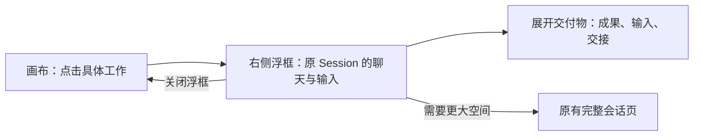

## 核心体验

**点击工作流中的具体 Agent 工作，在画布右侧的浮框里查看同一个会话。** 聊天、工具记录、权限请求和输入框复用现有能力；交付物收在浮框内的折叠区。需要更大空间时，再打开完整会话。

浮框沿用运行画布已有的形态：桌面约 `440px` 宽，四周留空，无背景遮罩或模糊，画布仍可操作。浮框叠放在画布上，画布尺寸、缩放和平移不因打开而变化。

产品代码已接入共享会话浮框和框内文件预览。本目录保留已确认的设计与静态原型；具体组件、实施范围与验证结果见[实施与验收](./delivery-plan.mdx)。

## 看交互稿

打开[可点击原型](./interaction-preview.html)：

1. 在画布点“资料研究”，观察右侧浮框，画布继续保留。
2. 展开“交付物”，查看当前工作的成果、输入和交接。
3. 打开文件后返回，聊天位置与输入草稿保留。
4. 切换工作或点击其他 Node，同一个浮框切到准确的会话。
5. 关闭浮框回到画布；也可按需打开原有完整会话。

原型只示意现有会话组件的放置位置，没有挂载真实 React 聊天组件。发送禁用，消息与文件均为示例，不连接 Agent 或读写项目目录。顶部五场景切换用于评审。

<Frame caption="画布右侧的紧凑会话浮框：复用已有聊天与输入，交付物在框内展开。">
  
</Frame>

## 复用与新增

| 位置         | 处理方式                                              |
| ------------ | ----------------------------------------------------- |
| 外层容器     | 沿用画布的 FloatingPanel，桌面约 440px，右侧留白      |
| 聊天和输入   | 复用原有时间线、工具记录、权限请求、配置、附件与草稿  |
| 交付物       | 在浮框内增加折叠区，与聊天共用宽度                    |
| 工作流上下文 | 显示当前工作、准确执行者及必要的来源或切换入口        |
| 完整会话     | 使用已有 Workspace/Session 路由，保留 Host 范围       |
| 画布         | 保留 Agent 关系、流转、状态与分工，浮框打开时仍可操作 |

从侧栏、普通任务或工作流打开同一个 Session，都读取同一份历史、配置和草稿。浮框只改变承载位置，不建立另一套会话身份或发送队列。完整会话原有的 Inspector 继续使用原有布局，本方案不要求再添加一个文件侧栏。

## 点击规则

| 点击对象                                  | 展示内容                                                 |
| ----------------------------------------- | -------------------------------------------------------- |
| 已执行的 Agent Node、内部工作、Arena 候选 | 在同一个浮框中打开准确绑定的会话                         |
| 一个 Node 负责多项工作                    | 恢复上次查看的工作；首次优先活跃项，具体工作入口精确定位 |
| 拆分 Node                                 | 拆分 Agent 原会话，交付物区提供分工材料与工作清单        |
| 主 Agent                                  | 当前实例绑定的原主会话                                   |
| 尚无 Session 的工作                       | 显示真实等待原因，点击不创建会话或启动执行               |
| Human Gate、Condition、Edge、Arena 容器   | 展示对应决定、判断、交接或候选内容，有真实会话时提供入口 |

## 文档入口

| 想看什么                 | 文档                                     |
| ------------------------ | ---------------------------------------- |
| 直接体验浮框和交付物     | [交互原型](./interaction-preview.html)   |
| 浮框结构、关闭和切换规则 | [交互设计](./interaction-design.mdx)     |
| 五种协作玩法如何使用     | [玩法说明](./collaboration-patterns.mdx) |
| 组件复用与验收           | [实施与验收](./delivery-plan.mdx)        |

## 沿用的业务边界

- 一件业务任务对应一个工作流实例；正式重试或重做产生新 Run。拆分工作是内部子任务，不新增看板任务或动态 Node。
- Runtime 唯一调度，主 Agent 提交受限管理意图。聊天文字或文件出现不直接推进下游。
- 工作内容通过文件交接；文件引用不代表 Agent 已阅读，不代表历史内容快照。
- 正式受理后图与执行配置冻结；同一项目最多一个活跃 Run，Run 内可以并行，停止未确认仍保留占用。
- 使用原会话存储、输入队列与生命周期。关闭浮框只是收起界面，Agent 按真实状态继续运行。
- 交付物区只投影已有文件关系；成果引用和 Agent 文件变更分别表达。
- Arena 仍有 Git/worktree/差异应用前提，通用报告择优不能仅靠 UI 宣称已支持。

运行协议沿用[文件驱动工作流设计](../ai-workflow/p0-file-driven-workflow/design.mdx)。本目录负责交互、展示和组件接入设计。
