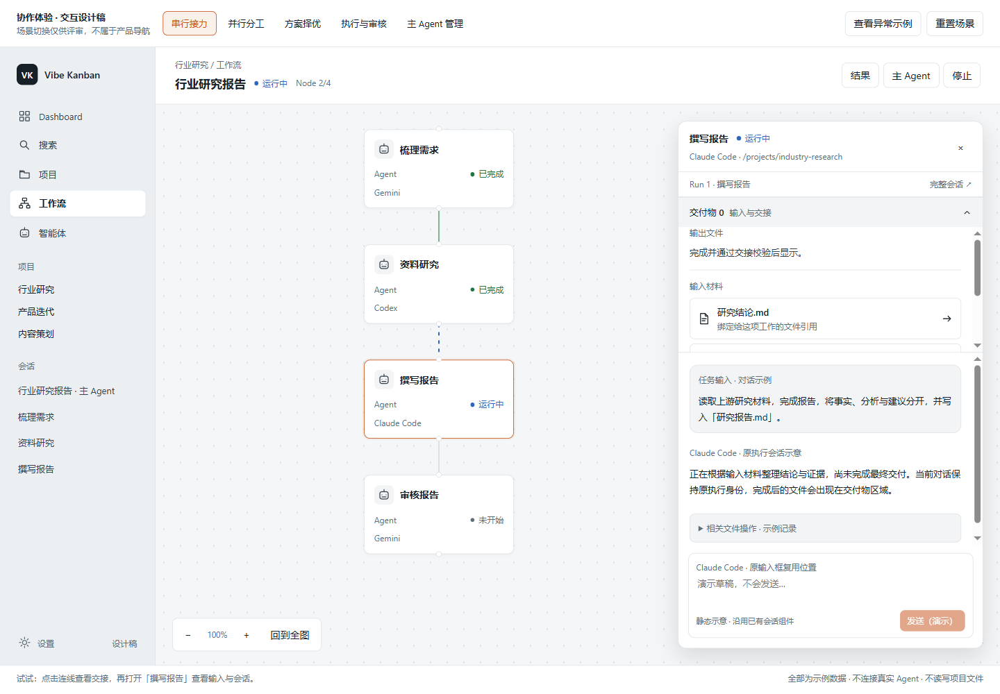
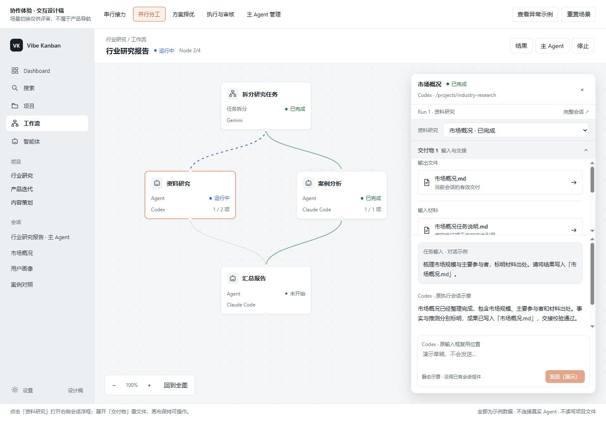
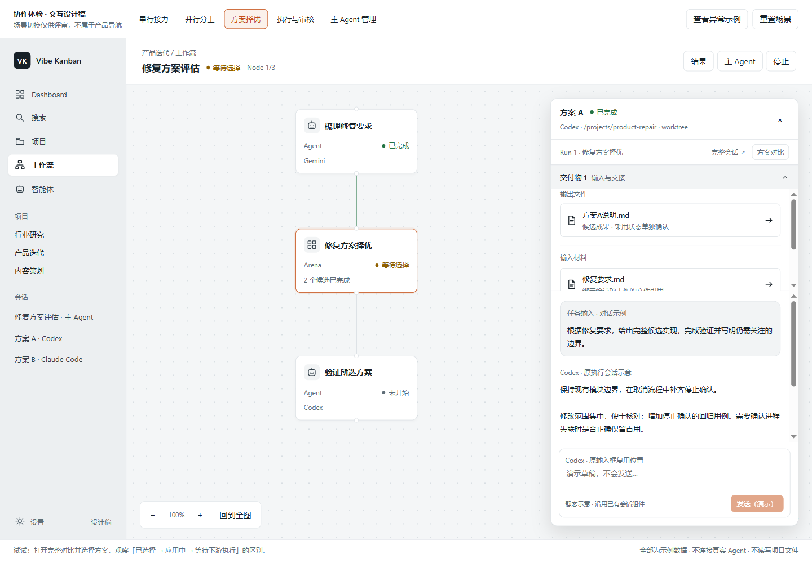
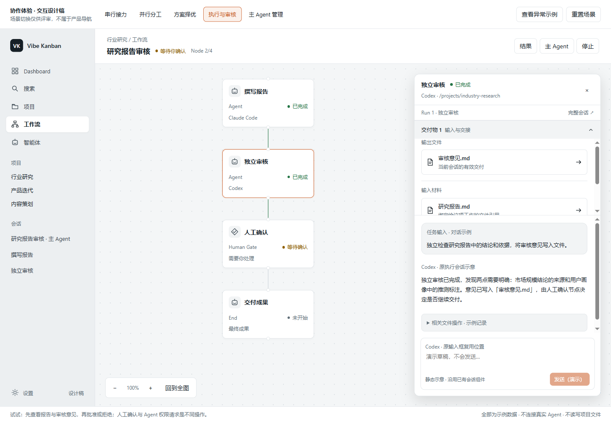
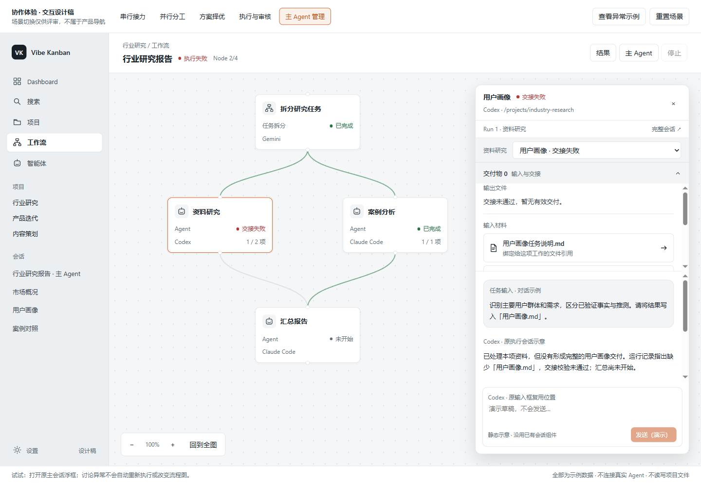

## 共用体验

五种玩法共用右侧会话浮框：画布点击具体 Agent 工作，浮框显示准确 Session 的原有消息与输入组件，画布继续可操作。成果、输入与交接收在框内的“交付物”折叠区，需要更大空间时打开原有完整会话。切换与关闭规则见[交互设计](./interaction-design.mdx)。

下面是[静态原型](./interaction-preview.html)的布局示意。消息区域标注已有组件的复用位置，不能据此另做一套生产聊天组件。

## 1. 串行接力

研究、撰写和审核依次完成工作。点击哪一步，浮框就显示哪一步的会话；展开交付物看它收到什么、交付什么。

<Frame caption="串行接力：在右侧浮框查看撰写报告的会话，上游材料和本步成果在框内展开。">
  
</Frame>

| 操作         | 结果                                   |
| ------------ | -------------------------------------- |
| 点“撰写报告” | 浮框显示 Claude Code 对应的原会话      |
| 展开交付物   | 区分本步成果和研究结论等上游输入       |
| 打开研究结论 | 在浮框内复用文件查看器，返回后草稿保留 |
| 关闭浮框     | 原画布位置保留，流程继续按真实状态运行 |

交接校验通过只证明引用按机制交接，不代表下游 Agent 已阅读。后续由 Runtime 按真实条件推进。

## 2. 并行分工

资料研究负责市场概况、用户画像，案例分析负责案例对照。画布仍是固定执行 Node，各项内部工作绑定自身 Session。

<Frame caption="并行分工：具体工作在同一个右侧浮框切换，交付物属于当前选择的工作。">
  
</Frame>

| 操作             | 结果                                                   |
| ---------------- | ------------------------------------------------------ |
| 点“资料研究”     | 打开当前或上次查看的工作会话，并明确当前项             |
| 切到“市场概况”   | 同一浮框精确切到该 Session，用户画像的草稿仍属于原会话 |
| 点拆分 Node      | 拆分 Agent 原会话，交付物区有分工材料和工作清单        |
| 从清单点案例对照 | 切到该工作会话，并可返回分工清单                       |
| 点未开始的汇总   | 浮框说明还在等哪项有效交付，不创建假会话               |

执行 Node 的 `1/2` 只统计它负责的工作，拆分层的 `2/3` 才统计整个批次。内部子任务不是新的看板任务，也不变成动态画布 Node。

共享目录不等于共享会话；会改同一文件的工作需合理串行或使用现有隔离方式。一项失败时其他成果保留，正式重试或部分汇总依现有规则产生新 Run，不靠前端跳过。

## 3. 多方案择优

点候选在浮框看其会话和成果；对比和采用仍在准确候选组的管理界面。

<Frame caption="方案择优：候选 A 的会话在右侧浮框打开，保留候选身份和返回候选组的入口。">
  
</Frame>

| 操作       | 结果                                           |
| ---------- | ---------------------------------------------- |
| 点 Arena   | 原候选列表、状态与对比入口                     |
| 点候选 A/B | 同一浮框显示准确原会话，文件、目录和状态不混用 |
| 返回候选组 | 恢复原 Arena 上下文，再比较或选择              |
| 采用方案   | 确认准确对象和影响，成功应用后才展示下游开始   |

聊天中的自我评价不构成推荐或选胜。未采用并成功应用前，后续验证不能默认绑定任一候选文件。现有 Arena 仍有 Git/worktree/差异应用前提，普通报告择优需要另行补齐机制。

## 4. 执行与审核

写作和审核分别使用自己的原会话。报告是审核输入，审核意见是审核成果；人工确认是工作流待办。

<Frame caption="执行与审核：右侧浮框显示审核会话，展开交付物阅读报告和审核意见。">
  
</Frame>

| 操作       | 结果                                                     |
| ---------- | -------------------------------------------------------- |
| 点独立审核 | 原有消息、工具记录与输入框显示在浮框                     |
| 展开交付物 | 审核意见与输入报告分组展示                               |
| 点人工确认 | 切换为真实待办，批准和拒绝有明确结果                     |
| 要求返工   | 从主会话或已有管理入口指定要求与范围，正式重做产生新 Run |

审核意见、Agent 权限和 Human Gate 分开处理。聊天补充要求不构成人工批准；拒绝后走配置中的合法路径，不擅自生成返工回环。

## 5. 主 Agent 管理

“主 Agent”入口在同一个浮框打开当前实例绑定的原主会话。它与侧栏里的这段会话相同，可以讨论进度、异常和恢复要求。

<Frame caption="异常处理：失败工作的会话与交付缺失在右侧浮框查看，可切换到原主会话讨论恢复。">
  
</Frame>

| 操作         | 结果                                                  |
| ------------ | ----------------------------------------------------- |
| 点失败工作   | 准确原会话、缺失文件与影响范围                        |
| 打开主 Agent | 同一浮框切到当前实例的原主会话                        |
| 查看汇总成果 | 展开交付物，明确每份成果的真实工作、Agent 与 Run 来源 |
| 精确重试     | 明确范围和复用成果，受理后显示新 Run 的真实状态       |
| 查看复用来源 | 切到来源原会话，再返回当前工作，不冒认当前执行已启动  |
| 关闭浮框     | 回到原画布位置，运行状态不受界面开关影响              |

Runtime 仍负责调度。普通通知不自动唤醒主 Agent；拆分后的系统分工轮次沿用既有规则。停止未确认仍保留项目占用，主 Agent 也不修改已冻结图或临时创建新的业务任务。
