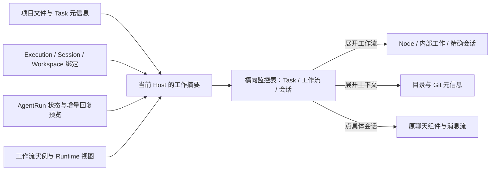

## 这页解决什么问题

你同时让多个 Agent 做事时，可以在一个横向监控表中看清：**正在执行哪些工作、哪些属于 Task 或工作流、在哪个项目和目录中做、最新回应是什么、是否需要你介入。**

更新于 2026-10-19。横向运行监控台已接入 `/dashboard`：展示真实元信息，覆盖各种工作方式下的 Agent 会话，并用不同颜色区分工作方式。下述分组、筛选、子行展开、按需上下文和原会话浮框已实现；实际验证结果与限制见[实施计划的验证记录](./plan.md#93-实际验证记录)。

代码落点、数据契约、实施步骤与验证范围见[代码实施计划](./plan.md)。本页负责页面与交互设计，计划负责如何接入现有项目。

“项目上下文”具体指项目名称、关联 Task、实际工作目录、Git 仓库、分支和 remote。已有任务状态可以展示；没有来源的业务阶段、经营目标和完成百分比不生成。

## 一张监控表，几种真实工作

### 会话是共同的监控基础

**只要是当前 Host 上 Vibe Studio 已接入管理的 Agent 会话，就应进入统一监控范围，不因从哪个入口启动而遗漏。** Task 执行、独立会话、工作流主 Agent、Node、拆分内部工作和 Arena 候选都遵循这条规则。

Session 是定位聊天、历史和上下文的共同载体，具体运行状态由它绑定的 AgentRun 提供。工作方式决定如何组织、标记这些会话，不改变会话身份或建立另一份历史。工作流仍由 Runtime 控制流转；Human Gate、Condition 等没有 Session 的控制节点保留流程状态，不虚构会话。

- 活跃会话不依赖浏览器曾打开它、左侧列表已加载它，或当前是否展开工作流。全局摘要与计数必须覆盖折叠中的实际运行。
- 工作流与 Arena 可以在父行下组织会话，父行显示活跃数和待处理原因，展开可定位每个会话。折叠是展示方式，不是监控范围限制。
- 关联尚未解析、任务暂时不可读或父对象缺失时，仍保留会话的运行状态和原会话入口，标明关联异常；不能通过强制关联查询把它过滤掉。
- 同一 Session 被多个上下文引用时按 Host + Session 去重，展示真实归属，其他位置保留引用；复用历史会话不再次计为正在运行。
- 本页覆盖平台已管理的会话。未经接入的原生 CLI 历史或系统中任意 Agent 进程，不会仅因存在于主机上就自动变成 Dashboard 会话。

### 工作方式决定行的组织

表格第一层展示工作，展开后查看具体执行与会话。**Task 和工作流共用列布局，但状态来源、展开内容和打开目标各自明确。**

| 行类型 | 一行代表什么                        | Agent 与状态                           | 展开或打开                                    |
| ------ | ----------------------------------- | -------------------------------------- | --------------------------------------------- |
| Task   | 关联业务 Task 的一次普通 Agent 执行 | 对应 Agent、该会话本轮运行状态         | 有准确 Session 时直接打开原会话               |
| 工作流 | 一个已经创建的工作流实例            | 整体运行状态、活跃 Node 数及参与 Agent | 展开主 Agent、Node 与内部工作；可打开原工作流 |
| 会话   | 未归入上述执行的独立会话            | 对应 Agent、该会话本轮状态             | 打开原会话，正常显示所属项目或默认项目        |
| Arena  | 已有的独立 Arena 执行（存在时）     | 读取原 Arena 状态，列出实际候选        | 展开候选会话或进入原有对比页面                |

这里的“Task / 工作流”是监控行的展示类型，不新增两套业务任务：**工作流仍然关联一个 Task。** 工作流行第二行显示关联 Task；不会再为同一次工作流执行生成一个重复 Task 行。

一个 Task 可以有多次执行。普通执行按执行名称区分，例如“结算体验优化 / 实现”和“结算体验优化 / 检查”；不把它们合成一个无法判断哪个 Agent 在工作的状态。Task 如果另有工作流执行，工作流单独成行并保留同一个 Task 关联。

展开的 Node、工作流内部子任务、候选和主 Agent 会话只出现于所属工作下，不再次复制到顶层“会话”行。业务类型与归属依赖真实 binding，不靠标题或目录猜测。暂时无法解析归属的活跃会话保留为“关联待确认”，不能漏掉。

## 一眼看到的页面

沿用固定左侧导航。右侧改为充分利用可用宽度的监控表，不继续套用上一稿 1120px 的居中卡片区。表格有一套共享列头、连续横行和细分隔线；项目可以用淡色分组行展示。

以下名称、数量、回复都是示例。

```text
┌──────────────────┬───────────────────────────────────────────────────────────────────────────────────┐
│ Vibe Studio      │ Agent 运行监控台                                           刚刚更新   [刷新]       │
│ 本机             │ 当前工作 4 项 · 活跃会话 6 个                                                     │
│                  │ [搜索…] [筛选]                                                                    │
│ 新建会话         │                                                                                   │
│ Dashboard ←      │                                                                                   │
│ 搜索             │ 状态        类型       工作 / 关联 Task    项目 / 工作位置     Agent    最新动态 / 回复│
│ 项目             │ ───────────────────────────────────────────────────────────────────────────────── │
│ 工作流           │ 产品网站                                                                          │
│ 智能体           │ ● 执行中    Task       结算体验优化        产品网站            Codex    正在执行检查 │
│                  │   8 分钟               实现               website · feat/pay           “表单已调整…”│
│ 项目             │ ───────────────────────────────────────────────────────────────────────────────── │
│ 产品网站         │ ◇ 等待批准  Task       结算体验优化        产品网站            Claude   等待执行命令 │
│ 资料研究         │                        检查               api · main                   “需要验证…”  │
│ 默认项目         │ ───────────────────────────────────────────────────────────────────────────────── │
│                  │ 资料研究                                                                          │
│ 会话             │ ● 执行中  ▾ 工作流     竞品调研交付        资料研究            3 Agent  2 执行 · 1 等待│
│ 调整结算页       │   12 分钟              Task：竞品分析     /work/research               整理：“已汇总…”│
│ 整理竞品资料     │            ├ 主 Agent  调研协调            同上                Codex    等待后续输入 │
│ 审核调研结果     │            ├ Node     资料整理            同上                Gemini   正在整理资料 │
│                  │            └ Node     交叉核验            同上                Claude   正在核对来源 │
│                  │ ───────────────────────────────────────────────────────────────────────────────── │
│                  │ 默认项目                                                                          │
│                  │ ● 执行中    会话       讨论产品名称        默认项目            Codex    “可以从这几个…”│
│                  │                                           …/workspaces/abc                     5 秒前│
│ 设置 / 用户 /版本│                                                                                   │
└──────────────────┴───────────────────────────────────────────────────────────────────────────────────┘
```

工作流在初次进入时默认折叠，展开示意用于说明层级。展开后即使 Agent 状态改变，也不会自动收起、切换选中会话或重排子行。

“赛博朋克监控大盘”的视觉方向采用克制的终端感：细网格、清晰对齐、等宽数字、低亮度分隔和少量状态高亮。沿用产品主题与 Agent 品牌色；深色主题体现监控台氛围，浅色主题保持同样的信息结构。没有装饰性图表、扫描线、持续闪烁或大面积霓虹光。

## 用颜色区分工作方式

工作方式使用固定色系，颜色主要落在**类型标签、类型图标和行首细色线**。行背景保持统一的低对比度底色；悬停、选中仍用产品既有交互样式，不把整行涂成高饱和色块。

| 工作方式   | 建议色系 | 标签与适用位置                                                      |
| ---------- | -------- | ------------------------------------------------------------------- |
| Task 执行  | 蓝色     | `Task` 标签，对应普通任务执行行                                     |
| 工作流     | 紫色     | `工作流` 标签、父行，以及主 Agent / Node / 内部工作行的工作方式标记 |
| 独立会话   | 青色     | `会话` 标签，包括默认项目中的独立会话                               |
| Arena      | 洋红色   | `Arena` 标签、独立对比执行和真实候选分组                            |
| 关联待确认 | 中性灰   | 保留“关联待确认”文字，不能猜测成某一种已知方式                      |

同一个 Codex 可以出现在蓝色 Task 行、紫色工作流行或青色独立会话行；它在 Agent 列中的品牌标识保持原样。工作流里的 Arena 候选分组可以使用洋红色，但保留上层紫色工作流的层级关系，表示该候选的实际工作方式。

三类颜色各有固定位置和含义：

| 信息       | 位置                       | 规则                                                       |
| ---------- | -------------------------- | ---------------------------------------------------------- |
| 工作方式   | 类型列、行首细线           | 回答“通过哪种方式开展工作”；不会因成功或失败改变色系       |
| 执行状态   | 状态列的状态点、图标和文字 | 沿用现有运行、等待、失败、结束状态色；不能套用工作方式颜色 |
| Agent 品牌 | Agent 列的 Logo 与名称     | 沿用六家 Agent 品牌组件，不控制整行配色                    |

例如工作流发生失败，类型仍是紫色“工作流”，状态列单独显示错误色和“失败”；不能把工作流整体改成红色类别。类型图标与文字始终保留，不能只凭颜色辨认。

深浅主题分别使用对应的语义 token，具体色值在实现时校验；普通文字对比度至少 4.5:1，必要的状态图形至少 3:1。高对比模式下保留边界、类型文字、图标和焦点，不能依靠荧光或透明度区分方式。工作方式色不复用现有 Agent 品牌色 token。

## 固定列，按类型展示内容

| 列               | Task / 会话行                                      | 工作流行                                                 |
| ---------------- | -------------------------------------------------- | -------------------------------------------------------- |
| 状态             | 本轮运行状态、运行时长                             | 实例当前运行状态、该次运行时长；需要介入时另标原因       |
| 类型             | Task 或会话；已有独立 Arena 保留其类型             | 工作流，带展开按钮                                       |
| 工作 / 关联 Task | Task 标题 + 执行名称；独立会话显示会话标题         | 实例名称 + 关联 Task，展开后显示主 Agent、Node、内部工作 |
| 项目 / 工作位置  | 项目、实际目录；Git 时附仓库和当前分支             | 工作流当前运行目录；子项有不同目录时分别显示             |
| Agent            | 原有品牌标识与名称                                 | 参与 Agent 标识与数量；展开后逐个看执行者                |
| 最新动态 / 回复  | 当前工具或等待原因 + 最新 assistant 原文片段和时间 | Node 执行概况 + 带来源的最新回复或运行事件               |
| 行内操作         | 会话入口、上下文                                   | 展开、原工作流入口、上下文；已绑定时提供主会话入口       |

工作名称和最新回复分配较多宽度。普通横行建议约两至三行文字高，标题和回复有上限；完整内容从会话查看。项目分组时可弱化重复项目名，但不同工作目录不能被省略成一个默认路径。

模型与思考等级放在上下文或可展开的 Agent 信息中，不把主表挤满。采用本次运行已观测到的值；只有启动配置时标“请求值”，两者都没有则说明“本次运行未报告”。工作流没有一个代表所有 Node 的“统一模型”。

### 工作流展开后的内容

```text
状态          类型 / 工作                         Agent        最新动态 / 回复
──────────────────────────────────────────────────────────────────────────────
● 执行中    ▾ 工作流  竞品调研交付                3 Agent      2 Node 执行 · 1 待开始
              Task：竞品分析                                   整理 · Gemini：“已汇总…”
                ├ 主 Agent  调研协调              Codex        本轮已结束
● 执行中        ├ Node      资料整理              Gemini       正在整理定价资料
                │   ├ 内部工作  产品 A                          “已读取公开价格…”
                │   └ 内部工作  产品 B                          “正在整理套餐差异…”
● 执行中        ├ Node      交叉核验              Claude Code  正在核对资料来源
○ 待开始        └ Node      输出报告              尚未启动     等待前置工作
──────────────────────────────────────────────────────────────────────────────
```

一项具体内部工作有自己的会话绑定时，点击它打开那个 Session；多个内部工作共用一个 Agent 类型，也不能随意打开最近一个会话。主 Agent 本轮结束，工作流仍可以继续运行。

Node 只在展开时查询，内部工作多时在该父行下分页。只保留“工作流 → Node → 内部工作 / 候选”的必要层级，不建设无限嵌套树。工作流内部子任务不变成看板 Task。

Human Gate、Condition 等无会话的控制节点保留真实状态与原工作流操作入口，不创建假会话。复用历史成果的节点标明“复用”，不计为活跃 Agent。

### 上下文按需展开

点击行内“上下文”，在该行下展开字段区，不额外建一个详情页面。工作流展开子行与上下文是两个独立动作。

```text
● 执行中   Task   结算体验优化 / 实现   产品网站   Codex    “表单验证已调整…”  [上下文 ▴]
──────────────────────────────────────────────────────────────────────────────────────
    项目 / Task     产品网站 / 结算体验优化 · In Progress
    会话            调整结算页                         [打开原会话]
    实际工作目录    /home/me/work/website              [复制路径]
    目录模式        直接使用目录
    仓库 / 分支     website / feature/checkout
    Git remote      origin    git@github.com:example/website.git
                    upstream  https://gitlab.com/example/website.git
    本次模型 / 等级 运行报告的模型标识 / 等级
    本轮开始        10:21:04          最近活动  10:29:16
──────────────────────────────────────────────────────────────────────────────────────
```

- 已启动会话以实际工作目录为准，项目后来修改默认目录不改变已有会话。
- 目录模式与是否 Git 分开：直接使用的目录也可能是 Git；worktree 展示自身目录、当前分支和所属仓库。
- 多仓库分别列出，不用一个仓库代表整个工作。工作流子会话有独立目录时不能一律写“同上”。
- remote 从执行主机的本地 Git 配置读取，支持多 remote、SSH、自建服务和本地路径，不依赖联网检查。“未配置远程”与“读取失败”分开。
- 能可靠转换成 HTTP(S) 仓库网页的地址才提供外链；路径可复制，URL 中的密码或 token 不进入展示与复制内容。
- detached HEAD 显示短提交号，未知分支明确标注；不拿基础分支冒充实际分支。
- 普通目录、默认项目正常展示；缺失关联不自动补建 Task 或迁移目录。

## 点击原对象，继续原来的工作

建议保持“点具体 Agent 工作就是原会话”的体验。复用 `FloatingPanel` 和 `WorkspaceSessionConversation`，沿用[工作流会话浮框](../multi-agent-workflow-ux/README.mdx)约 440px 的桌面宽度、四周留白、无背景遮罩和完整会话入口。

| 点击位置                    | 行为                                                          |
| --------------------------- | ------------------------------------------------------------- |
| Task / 独立会话行的工作标题 | 有准确 Session 时打开原会话浮框；缺少绑定则说明原因，不新建   |
| 工作流父行的展开按钮        | 展开 / 收起内部工作，不随意选择某个 Agent                     |
| 工作流实例名称              | 进入原工作流运行页面                                          |
| 工作流的“主会话”入口        | 打开准确绑定的主 Agent 会话；未绑定时不伪造入口               |
| Node / 内部工作 / 候选标题  | 有准确 Session 就打开该会话；无会话的控制节点回到原工作流处理 |
| 最新回复片段                | 打开片段来源 Session；运行事件没有 Session 时进入所属工作详情 |
| 项目或关联 Task 链接        | 进入原页面，不顺带触发展开或打开会话                          |
| 上下文、复制路径            | 只执行当前动作，文字仍可选中复制                              |

```text
┌──────────────┬──────────────────────────────────────────────────────┐
│ 原侧栏       │ Agent 运行监控台                                     │
│              │                                                      │
│ Dashboard ←  │ 状态 / 类型 / 工作      ┌──────────────────────────┐ │
│ 项目         │ ─────────────────────── │ 资料整理    [完整会话] × │ │
│ 工作流       │ 工作流：竞品调研交付    │ 原有会话与上下文         │ │
│ 智能体       │   Node：资料整理 ←      │                          │ │
│              │   Node：交叉核验        │ 原有消息、工具、权限请求 │ │
│ 项目列表     │ ─────────────────────── │                          │ │
│ 会话列表     │ Task：结算体验优化      │ 原有输入框与配置         │ │
│              │                         └──────────────────────────┘ │
│ 设置等       │                                                      │
└──────────────┴──────────────────────────────────────────────────────┘
```

浮框叠放在右侧，不推挤表格列宽；打开时给原行保留选中标记。切换会话保留各自草稿与滚动位置；关闭返回原位置和焦点，不停止 Agent。打开完整会话或工作流再返回，恢复筛选、展开状态和滚动位置。

审批、补充输入、停止、重试仍由原会话或工作流处理，不在监控台复制控制协议。工作流交付物复用原文件上下文组件，普通会话不伪造交付物。所有打开目标保留 Host 身份。

窄屏继续使用横行与分隔线，合并次要列、上下排列单元信息；保留类型、名称、状态和最新动态。完整路径、模型与更多操作进上下文；会话使用现有完整页面。表头可吸顶，但不能挡住首行；不在窄屏重新变成一组卡片。

## 不同对象的状态不能混用

### Task 执行和独立会话

当前有非终态 AgentRun 就展示它；否则显示最近一轮结果。Task 看板状态作为上下文单独展示，不能和执行状态混为一谈。

| Runtime 状态                           | 行内文字                | 筛选归类                         |
| -------------------------------------- | ----------------------- | -------------------------------- |
| `pending` / `starting`                 | 等待启动 / 正在启动     | 执行中                           |
| `running`                              | 正在执行                | 执行中                           |
| `awaiting_input` / `awaiting_approval` | 等待你的回复 / 批准     | 等你处理                         |
| `cancelling`                           | 正在停止                | 执行中，直到终态确认             |
| `succeeded` / `cancelled`              | 本轮已结束 / 本轮已停止 | 最近结束                         |
| `failed` / `crashed`                   | 本轮失败 / 运行意外中断 | 最近异常                         |
| `audit_failed`                         | 运行记录校验失败        | 最近异常，不据此判定业务交付结果 |

**一轮结束不等于 Task 完成或会话关闭。** 无运行记录显示“尚未开始”，不计为活跃。同一 Session 异常地存在多个非终态 Run 时保留全部运行身份，标明多轮运行，不能取最新一个隐藏其他运行。

### 工作流

父行以实例及其当前 Run 的 canonical 状态为准，不使用主 Agent 或某个 Node 的状态替代。

| 工作流情况                           | 父行展示                                                       |
| ------------------------------------ | -------------------------------------------------------------- |
| `pending` 或 `running`               | 等待执行 / 执行中，附实际 Node 执行计数                        |
| `awaiting_human` 或 `awaiting_arena` | 等待人工处理 / 等待候选选择，明确入口                          |
| `cancelling`                         | 正在停止，仍保留直到 Runtime 确认                              |
| `succeeded` / `failed` / `canceled`  | 本次运行已结束 / 失败 / 已停止；有部分交付时保留其标记         |
| 某个 Node 失败而流程仍在运行         | 整体仍显示执行中，附“1 个 Node 失败”；不擅自宣称整个工作流失败 |
| 并行 Node 一部分等人、一部分执行     | 同时显示“仍有执行 / 有待处理项”，展开可定位到具体项            |
| 主 Agent 暂无活跃 Run                | 主会话显示真实状态，工作流父行继续按 Runtime 展示              |

工作流模板只是定义，不进入运行监控表；尚未开始的实例留在原工作流入口，不计入当前工作。

等待人工的控制节点没有 Session，也必须在工作流父行提示。完成、复用、跳过、失败分别计数；动态拆分不具备固定总工作量时，展示已发生数量，不画虚假的百分比进度条。

### 最新回复与当前动态

- 回复只取实际 assistant 消息，按消息 ID、attempt 和事件顺序合并，遵循现有聊天语义。工具和错误记录单独展示。
- 工作流父行显示当前 Run 内最近的真实回复，并带“Node / 内部工作 · Agent”来源和时间；没有回复时可显示有来源的 Runtime 事件，不把它写成 Agent 发言。
- 主 Agent 的结论和某个 Node 的片段明确区分，不把其中一句自动升级为整个工作流的交付结论。
- 新 Run 尚未回复时显示“本次运行暂无回复”；保留旧内容必须标“上次运行”。同一 Run 内不同子会话的运行身份也要保留。
- 预览用轻量纯文本，默认一至两行；完整 Markdown、代码、附件和交付物在原会话查看。
- 最近活动不是会话改名的 `updated_at`，也不是进程心跳。结束后的工具活动不能继续写成“正在执行”。
- “8 分钟没有新活动”只描述事实，不推断卡死、不自动停止、不限制 Agent 时长。
- 投影故障、页面断线和 Agent 执行失败分开；断线保留最后已知数据与时间，明确其不再实时。

## 筛选、计数和稳定更新

固定展示进行中的工作，按项目分组。等待输入、审批、Human Gate 或候选选择的工作仍未结束，继续保留；已经完成、失败、取消及尚未开始的独立会话不进入顶层列表。父工作虽已终止但仍有真实活跃 Agent 时继续保留，直到这些 Agent 结束。类型支持 Task、工作流、会话以及已有 Arena；项目、Agent 和工作目录类别用于进一步筛选。页内搜索工作名称、关联 Task、项目、会话与已解析目录，不读取全部聊天或磁盘文件。

列表是页面主体。标题区只保留页面名称、更新时间和刷新；工具栏只显示小搜索框和“筛选”入口，不提供状态切换或历史时间范围。类型、项目、Agent、目录类别与项目分组选项收进筛选浮框，按需展开。存在额外过滤条件时，入口显示数量，并可在浮框内清除；搜索框保留自己的清除按钮。

| 控件       | 建议行为                                                                              |
| ---------- | ------------------------------------------------------------------------------------- |
| Agent 筛选 | 任一真实子会话匹配就保留其工作流父行，注明“匹配 2 个会话”；不把整个工作流改成单 Agent |
| 分组       | 按项目或不分组；Agent 先作为筛选，避免一个多 Agent 工作流在多个分组重复出现           |

活跃和长期等待的工作不受时间窗截断。行内保留真实运行状态和并行情况；正在运行的工作流展开后可查看其已完成或失败的 Node，便于理解流程上下文。

**工作数量和会话数量分开。** 顶部明确“当前工作 4 项 · 活跃会话 6 个”：工作按顶层执行 / 工作流实例 / 独立会话去重，活跃会话按 Session 去重。展开多少 Node 不改变工作总数，控制节点不增加会话数。

数量使用同一 Host、搜索和其他筛选条件，覆盖全部匹配的进行中工作，不是侧栏已加载数量。每页 20 个顶层工作，内部工作单独按需分页；界面标明已显示与总数，所有实际活跃会话均可定位。

首次加载、切换筛选或主动刷新时，按需处理优先、再按真实活动时间排序，使用稳定 ID 打破并列。流式内容原地更新，不逐字重排；结束的工作在下次轮询时移出列表，剩余行保持相对顺序，页码越界时回到最后一个有效页。新增工作或次序变化提示“有更新”，由用户应用新排序。移出列表不会关闭已经打开的会话浮框，也不会停止 Agent。

搜索或 Agent 筛选匹配到折叠子项时，保留父行并标明命中来源；可以展开查看全部工作，不让过滤隐藏其等待原因。选中的子项不会因更新自动跳到另一个会话。

## 已有基础与需要补的能力

| 范围             | 已有来源                                                                             | 本次需要补充                                                            |
| ---------------- | ------------------------------------------------------------------------------------ | ----------------------------------------------------------------------- |
| 页面             | `DashboardPage.tsx` 四个占位分区；`appShell.ts` 将 Dashboard 设为 Contained          | 替换为横向监控表，Dashboard 改为利用右侧宽度；其他页面布局不随之改变    |
| Task 与执行      | 项目文件权威数据、`ExecutionSummary`、`ExecutionOpenTarget`                          | 组合 Task 标题与具体执行，一次执行只对应一条顶层工作                    |
| 会话与目录       | `SessionListItem`、`Session.agent_working_dir`、Workspace / Repo                     | 补齐反向归属、实际目录与独立会话；避免遗漏工作流内部会话                |
| Agent 状态与配置 | `AgentRunSummary.state`、`RunState.observed_configuration`、启动配置                 | 按准确 Session / Run 批量读取，不能套用工作区最新状态或当前全局默认模型 |
| 工作流状态       | `WorkflowAttemptResponse`、`WorkflowRunRuntimeView`、Node、split batch、会话目标解析 | 父行摘要、待处理原因、懒加载子行和最新回复来源                          |
| Git remote       | `repo.rs::get_repo_remotes`、`GitService::list_remotes`                              | 上下文按需读取，按 Host / 仓库缓存；普通 Repo 列表没有 remote 字段      |
| 最新回复         | canonical 消息 / 工具事件、终态 `terminal_output`                                    | 轻量增量预览；只看终态输出无法显示执行中的响应                          |
| 会话浮框         | `FloatingPanel`、`WorkspaceSessionConversation`、工作流浮框                          | 增加监控行的选择与打开绑定，复用原聊天、输入和权限处理                  |

项目业务任务仍以项目目录的 `.vibe-kanban/project.json` 为权威，执行与会话数据使用现有运行存储。监控行是派生视图，不新增一套可编辑的 Task / 工作流实体，也不以旧 SQL 业务投影替代不可读的项目文件。

### 摘要链路



建议一个只读摘要查询返回顶层行、筛选计数、分组和更新时间；展开再查询对应工作流的子项。服务端读取全部相关工作，不能靠前端已打开的 Node 拼出“全局”数据。接口路径与类型名在实施时确定，本稿不声称已有聚合 API。

聚合必须从当前 Host 的全部相关 Session / AgentRun 核对覆盖范围，再补齐 Task、工作流和 Arena 关系。只有成功关联业务对象的查询结果不能作为唯一会话来源；无法匹配的活跃会话以“关联待确认”保留。懒加载仅影响子行详情，不影响活跃数量、待处理提醒或搜索命中。

每行携带展示类型、源对象 ID、Host、关联 Task、当前 Run、可选 Session / Workspace、真实状态、待处理原因、目录概况、最新回复来源和打开目标。父行没有唯一 Session 时不硬填一个；最新回复额外携带准确 Node、子项、Session、Run 和消息 ID。未知、未加载、不可读分开表示。

顶层 key 按 Host + 行类型 + 执行 / 实例 / 独立 Session ID；子行再包含 Node 执行、内部工作或候选身份。正式重试换 Run 时保留父行身份，重置对应运行数据，不能继续显示上一 Run 的 Node 状态。

第一版建议一个页面级定时查询：前台约 2 秒刷新，隐藏标签页暂停，重新可见时补齐；已展开子项批量刷新。只有真正打开的会话连接完整消息流。所有缓存和路由包含 Host；本稿先覆盖当前 Host，不假装已聚合所有机器。

### 回复预览与性能

现有 `AgentRuntimeReadService::stats` 会遍历运行历史，不适合给每行反复调用。建议在 canonical 事件投影旁维护可重建的每 Run 轻量预览，包括消息 ID、attempt / sequence 游标、有界回复、工具活动和最后活动时间。

预览可以持久化，但仅是派生读数据。按事件身份去重，合并语义与原会话一致；版本失效时后台有界重建，界面标明准备中。每次刷新不扫描所有历史，不把消息另存为新的业务事实。工作流父行从这些预览选取有来源的最近内容。

- 回复片段保留有界长度（建议约 600 字符），界面裁切一至两行，不挂完整 Markdown。
- 行使用稳定 key，只更新变化的单元格。定时数字使用等宽数字，流式内容不触发行位移动画。
- Git 与目录信息按需读取、缓存；项目文件通过权威读取层按版本复用，不做每 2 秒一次的全目录扫描。
- 表格异步加载预留行高，展开只在用户操作时发生；大量子项分页，不一次挂载全部聊天。
- 使用有表头语义的结构，展开按钮提供展开状态和键盘操作；不因称作 Data Grid 就引入电子表格编辑或复杂键盘模式。
- 状态有文字和图标，颜色只辅助辨识。沿用主题、字体和品牌组件，减少动态效果设置生效，不逐字打断读屏。

## 边界与验收

监控覆盖还需逐项确认：Task、独立会话、工作流主 Agent、普通 Node、拆分内部工作、Arena 候选，任何一种已接入的活跃会话都不能因工作方式、折叠或关联缺失而遗漏。同一会话在多处被引用时只计一次。

配色验收覆盖同一个 Agent 在不同工作方式下出现、工作流失败、工作流内嵌 Arena、深浅主题及高对比模式：工作方式、运行状态和 Agent 品牌始终分别可辨认，更新状态不会改变工作方式色，关闭颜色仍可凭文字和图标辨别类型。

| 场景                                  | 应看到的结果                                                  |
| ------------------------------------- | ------------------------------------------------------------- |
| 同一 Task 有两次 Agent 执行           | 用执行名称区分两行；各自状态、回复、目录和会话绑定准确        |
| 工作流展开前后                        | 顶层始终一项工作，Node 与会话不重复计数；内部活跃会话全部可达 |
| 工作流运行但主 Agent 已结束           | 父行仍按 Runtime 展示执行中，主 Agent 子行显示本轮结束        |
| Node 有失败或等待，其他 Node 继续执行 | 保留整体状态，同时看得到失败 / 等待原因和准确处理入口         |
| Human Gate 无 Session                 | 工作流仍进入等你处理，控制节点可打开原操作页面                |
| 同工作区多个会话、多 Agent 并行       | 不用 Workspace 最新运行覆盖所有会话；最新回复均能追溯来源     |
| Agent / 搜索命中工作流内部项          | 父行保留且标明命中，展开能定位；全局数量不因展开变化          |
| 重试、新 Run、主机重启                | 原父行稳定，状态与回复换到本次运行；旧回复明确标注，不串运行  |
| 普通目录、Git、worktree、多 remote    | 路径和 Git 元信息准确，普通目录不报仓库错误                   |
| 全局默认模型、项目默认目录后来修改    | 已运行的会话保留实际配置来源和落盘目录                        |
| 浮框、完整会话、工作流来回切换        | 同一 Session、历史和草稿；返回恢复监控表的位置与展开状态      |
| 断线或元信息读取失败                  | 保留最后结果与时间，仅局部提示；不把统计归零或伪报成功        |
| 没有当前工作或筛选为空                | 用一行清楚的状态和清除筛选入口，不堆空白面板                  |
| 目录或任务文件暂时不可读              | 会话仍可定位，信息标为不可读，不自动补建 Task 或改目录        |
| 对象删除或绑定失效                    | 说明目标不存在，不跳到其他会话，不新建替代对象                |
| 长时间无输出                          | 展示最后活动时间，不推断卡死、不限制运行时长                  |
| 窄屏与浅色主题                        | 连续横行仍可读，主信息保留，次信息展开，不恢复卡片设计        |

## 实施顺序

1. **准确的工作摘要。** 覆盖全部已接入 Agent 会话，补齐各种工作方式的归属与去重；真实状态、回复来源和目录元信息。
2. **横向监控表。** 替换占位页面、调整 Dashboard 画幅，接入工作方式配色、进行中工作查询、类型筛选、项目分组、稳定刷新和工作流子行。
3. **原有入口联动与验收。** 浮框、完整会话、工作流处理入口、Host 范围、错误恢复、中英文、键盘和窄屏。

这是同一份 Dashboard 设计的修订，保留本目录作为入口。暂不增加经营分析、自动业务分类、项目阶段推断、预计完成时间、费用大屏、跨主机总控或批量执行控制。

## 与已有设计和源码的关系

- [早期页面布局](../frontend-redesign/02-layout-wireframes.md)：保留固定侧栏与真实状态来源；本稿将 Dashboard 从早期居中摘要页调整为横向运行监控台，解除固定 5 条活跃工作的限制。产品代码目前仍是占位实现。
- [多 Agent 工作流会话体验](../multi-agent-workflow-ux/README.mdx)：沿用原会话浮框、准确绑定、交付物与完整会话入口。
- [文件驱动工作流设计](../ai-workflow/p0-file-driven-workflow/design.mdx)：执行与流转仍归 Runtime；Dashboard 只展示并提供原功能入口。

以下源码用于实施核对；生成类型不可直接手改。

| 范围               | 代码                                                                                                                                                                                                                                                       |
| ------------------ | ---------------------------------------------------------------------------------------------------------------------------------------------------------------------------------------------------------------------------------------------------------- |
| 页面与布局模式     | [DashboardPage.tsx](../../../packages/web-core/src/features/app-shell/ui/DashboardPage.tsx)、[appShell.ts](../../../packages/web-core/src/features/app-shell/model/appShell.ts)                                                                            |
| 侧栏               | [ProductSidebar.tsx](../../../packages/web-core/src/features/app-shell/ui/ProductSidebar.tsx)                                                                                                                                                              |
| 会话、执行与列表   | [session.rs](../../../crates/db/src/models/session.rs)、[task.rs](../../../crates/db/src/models/task.rs)、[execution_data.rs](../../../crates/server/src/routes/execution_data.rs)                                                                         |
| 项目任务权威读取   | [project_store.rs](../../../crates/server/src/routes/project_store.rs)                                                                                                                                                                                     |
| 运行状态与历史读取 | [运行模型](../../../crates/db/src/models/agent_runtime.rs)、[运行读取服务](../../../crates/services/src/services/agent_runtime.rs)                                                                                                                         |
| 工作区摘要与 Git   | [workspace_summary.rs](../../../crates/server/src/routes/workspaces/workspace_summary.rs)、[repo.rs](../../../crates/server/src/routes/repo.rs)                                                                                                            |
| 聊天组件与消息合并 | [WorkspaceSessionConversation.tsx](../../../packages/web-core/src/features/workspace-chat/ui/WorkspaceSessionConversation.tsx)、[canonicalAgentConversation.ts](../../../packages/web-core/src/features/agent-runtime/model/canonicalAgentConversation.ts) |
| 工作流绑定与浮框   | [workflowConversationTarget.ts](../../../packages/web-core/src/features/workflow/model/workflowConversationTarget.ts)、[WorkflowConversationPanel.tsx](../../../packages/web-core/src/features/workflow/ui/WorkflowConversationPanel.tsx)                  |
