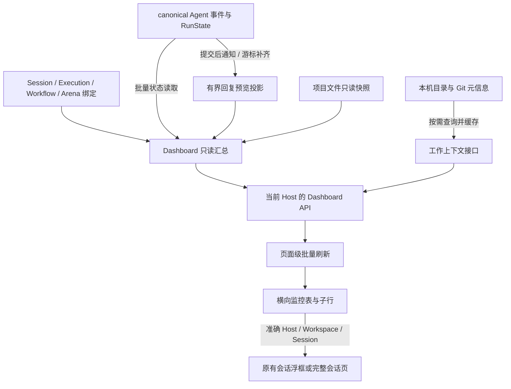

## 目标与当前状态

本计划对应[页面与交互设计](./README.mdx)，更新于 2026-10-19。你可以通过一个横向监控表，查看当前 Host 上各种工作方式的真实运行状态、所属项目与 Task、实际目录以及最新回复，并打开原来的会话继续处理。

**D1–D6 已实施，Dashboard 专项验收已完成。** 原 Dashboard 占位页已替换为真实接口驱动的横向监控表，预览投影和三个只读接口已接入现有生命周期与 Host 传输。相关后端测试、浏览器回归和真实 Codex 链路通过；全仓检查仍有桌面端编译与既有 lint 阻塞，具体结果和限制记录在 9.3。布局示意与交互细节以 README 为入口。

本次交付包括 Task 普通执行、独立会话、工作流主 Agent / Node / 内部工作、已有 Arena 候选。工作流内部工作不创建为看板 Task。先覆盖当前选中的 Host，保留已有本机与远程访问方式。

不新增聊天实现、Agent 调度协议、可编辑的 Dashboard 业务实体、跨主机总控、经营分析、自动阶段判断或估计完成百分比。

## 1. 对齐现有代码

| 已有能力        | 实际情况                                                                                   | 实施决定                                                                         |
| --------------- | ------------------------------------------------------------------------------------------ | -------------------------------------------------------------------------------- |
| Dashboard 页面  | `DashboardPage.tsx` 展示四个不可用分区，`appShell.ts` 使用居中画幅                         | 原路由替换为监控表，只有 Dashboard 调整为充分利用右侧宽度                        |
| 执行与业务 Task | Rust `models/task.rs` 中的主要运行模型名为 `Execution`，存在 Agent / Workflow / Arena 类型 | DTO 明确区分 `task_id` 与 `execution_id`，不按历史数据库列名推断业务含义         |
| 会话列表        | `Session::list_recent_all` 依赖项目 membership；工作区摘要取工作区最新 Run                 | 新查询从会话及运行反向汇总，关联使用可空连接，不能直接拿侧栏列表或工作区摘要替代 |
| Agent 状态      | `AgentRunRecord`、`AgentRunStateRecord` 与 `AgentRuntimeReadService` 已有 canonical 状态   | 批量读取准确 Session / Run；不从进程存活、前端消息缓存或 Task 看板状态推算       |
| 工作流状态      | `build_workflow_run_runtime_view` 已有 Node 状态与动作边界                                 | 复用当前运行投影规则，补齐主会话、拆分内部工作和候选归属；不另外编写流转器       |
| 项目文件        | `project_store.rs` 是 `.vibe-kanban/project.json` 的权威读取入口                           | 复用校验与文件定位，增加只读快照；文件不可读时不退回旧 SQL 任务标题              |
| 项目读取副作用  | 现有 `project_store::read` 会开启 `BEGIN IMMEDIATE` 并修复 SQL 投影                        | 不能每两秒为 Dashboard 调用一次；纯读取缓存不参与业务写事务                      |
| 消息变化通知    | `append_and_project` 提交 canonical 事务后发送 Run ID 广播                                 | 利用已有广播唤醒预览服务，广播丢失时从持久化游标补齐                             |
| 消息读取        | `AgentRuntimeReadService::stats` 会遍历事件历史                                            | 不在列表轮询中使用；补充每 Run 的有界预览投影                                    |
| 原会话          | `FloatingPanel`、`WorkspaceSessionConversation` 和工作流会话浮框已存在                     | 新增选择与绑定层，复用消息、输入、权限、附件和会话状态                           |
| Host 传输       | `localApiTransport` 支持显式 Host，安装的 transport 负责本机转发或远程中继                 | 新接口经过同一链路，页面不自行拼接第二层 Host 前缀                               |

源码定位见本文末尾。以上是实施依据；不为这次 Dashboard 顺带重构整个运行底座。

## 2. 总体结构与责任

| 层           | 负责                                          | 不负责                                   |
| ------------ | --------------------------------------------- | ---------------------------------------- |
| DB 读取层    | 批量运行查询、反向绑定、预览存取、必要索引    | 业务 Task 内容权威、UI 翻译与配色        |
| 预览服务     | 增量处理 canonical 事件、去重、游标与重建     | 改写 Agent 状态、解析另一份原生 CLI 协议 |
| 服务端汇总层 | 组织工作、筛选、计数、稳定分页、真实打开目标  | 启动、取消或审批 Agent                   |
| 前端数据层   | Host 范围、单一刷新周期、缓存、展开和选择状态 | 遍历全部聊天、推测归属                   |
| 前端展示层   | 共享列布局、类型配色、上下文和原会话入口      | 第二套聊天与工作流控制逻辑               |

## 3. 工作身份、归属与运行状态

### 3.1 顶层工作身份

| 展示类型   | 稳定身份                              | 下层内容                                           |
| ---------- | ------------------------------------- | -------------------------------------------------- |
| Task       | `execution_id`                        | 普通 Agent 执行绑定的会话与 Run                    |
| 工作流     | `workflow_attempt_id`，即已有实例身份 | 当前 Workflow Run 的主 Agent、Node、内部工作、候选 |
| 独立会话   | `session_id`                          | 当前活跃 Run，或最近一轮结果                       |
| Arena      | `arena_group_id`                      | 已有候选与汇总会话，按真实关联展开                 |
| 关联待确认 | `session_id`                          | 保留可读运行信息、原会话入口及关联问题             |

前端根行 key 使用 `Host + kind + id`。子行 key 使用真实 Node execution、split subtask 或 candidate ID，不能用数组位置或标题。Run 身份单独携带：重试不替换工作流父行，却必须更新子项查询范围和回复来源。

Task 展示中的 Task 是业务任务，Execution 是该任务的一次具体执行。一个 Task 有两次普通执行时显示两行；其中的工作流执行只显示为一条工作流父行，不再重复显示为普通 Task。

### 3.2 汇总流程

1. 批量取得全部非终态 AgentRun，以及满足历史时间窗的最近终态；同时取得活跃 / 等待的工作流与 Arena。无 Session 的 Human Gate 也必须通过工作流来源进入候选集合。
2. 根据 Session、Execution、Workflow Run、Node execution、split subtask、Arena candidate 的显式绑定解析归属。不能根据 Agent 名称、目录或标题匹配。
3. 按真实父对象组织工作。工作流内的 Node、内部工作、Arena 候选与主 Agent 不再出现在顶层独立会话列表。
4. 补齐项目文件中的名称与 Task 元信息。局部读取失败保留已有运行与会话，返回字段级问题；不因内连接或文件读取失败删除整行。
5. 在去重后的工作集合上执行搜索、筛选、计数与排序，再分页。展开只控制返回的子行明细，不影响后台对全部子项的筛选和计数。

活跃会话按 `Host + session_id` 去重。多处引用保留引用关系，不重复计数；绑定冲突显示“关联待确认”及候选关联，不能随意选一个归属隐藏其他工作。相同 Session 出现多个非终态 Run 时保留各 Run 身份并标明异常，活跃会话仍计一次。

旧 Workflow Run 仍残留活跃 Agent 时，也不能因实例切换到新 Run 而消失：在该实例下标为“其他运行仍活跃”，携带旧 Run 身份；不计入当前 Run 的 Node 进度或最新回复。

### 3.3 状态与计数契约

- 顶层列表只展示非终态工作，包含等待输入、审批与人工决策；已结束或尚未开始的独立会话不进入列表。工作流子项保留最近一轮结果，以展示流程上下文。
- 工作流父状态来自实例当前 Run。主 Agent 结束、某个 Node 失败或单个候选退出都不能直接改写工作流状态。
- Arena 保留现有 lifecycle 与候选运行状态两种信息；`open` 不等于 Agent 正在执行，候选结束也不等于已完成选择。
- 返回原始状态与展示分组；页面不提供状态切换。并行场景保留活跃数和等待原因；父工作已终止但仍有活跃 Agent 时保留。
- Agent 的 `cancelled` 与 Workflow 的 `canceled` 使用各自原类型，在展示映射处处理，不修改底层状态枚举。
- `work_count` 按顶层工作计；`active_session_count` 按去重会话计；`active_run_count` 可用于解释同一会话的多 Run 异常。控制 Node 不增加会话数量。
- Agent 筛选命中子会话时保留父工作，返回命中会话数与该工作的全部活跃会话数。顶部数量按当前筛选统计。
- 新一轮开始后不继续用上次失败分类；活跃与等待工作不受 24 小时 / 7 天 / 30 天历史窗口限制。

## 4. 查询接口与返回契约

### 4.1 接口安排

以下接口已挂到现有 `/api` 路由与 relay 校验链中，不新增单独监听端口或绕过已有 Host 权限。

| 接口                                            | 用途                                                       | 主要输入                                               |
| ----------------------------------------------- | ---------------------------------------------------------- | ------------------------------------------------------ |
| `POST /api/dashboard/query`                     | 只读批量查询根行、摘要，以及已展开的子页；页面轮询也使用它 | 筛选、根分页快照与页码、已展开子页引用、当前可见行引用 |
| `GET /api/dashboard/works/{kind}/{id}/children` | 用户首次展开或翻子页时按需查询                             | 父对象当前 Run ID、子分页游标、筛选摘要                |
| `GET /api/dashboard/works/{kind}/{id}/context`  | 用户展开上下文时读取完整目录与 Git 元信息                  | 可选准确子项 / Run 引用                                |

批量查询使用 POST 是为了容纳已展开子页与可见引用，语义仍为读取。接口不创建 Task、Session 或 Run，不改变工作流。请求引用数量、分页大小与文本长度必须有边界；所有引用在执行 Host 内重新解析，不能直接信任客户端提交的目录。

### 4.2 DTO 设计

在 Rust 定义带 `TS` 派生的返回类型，通过现有 `generate_types` 导出。下表是结构约定，不直接手写另一份 `shared/types.ts`。

| 类型                    | 必须包含的信息                                                                                                                             |
| ----------------------- | ------------------------------------------------------------------------------------------------------------------------------------------ |
| `DashboardQuery`        | 固定 `current` 查询进行中工作；类型、项目、Agent、目录类别、搜索词、项目分组方式、分页引用                                                 |
| `DashboardPageResponse` | 查询生成时间、列表快照身份、快照剩余工作总数、最新匹配总数、活跃会话数、根行、已展开子页、列表变化标记、局部问题                           |
| `DashboardWorkRef`      | 根行 kind 与稳定 ID；不使用客户端 URL 作为身份                                                                                             |
| `DashboardWorkRow`      | 工作身份、标题、项目 / Task / Execution 引用、原始状态、筛选分组、实际目录摘要、Agent 集合、活跃与待处理数量、预览、打开目标、元信息完整性 |
| `DashboardChildRow`     | 父工作身份、子项角色与 ID、Workflow Run / Node / 内部工作 / candidate 绑定、Session / AgentRun 引用、状态、是否复用历史结果、打开目标      |
| `DashboardReplyPreview` | assistant 纯文本片段、截断标记、事件时间、消息 ID、Session / AgentRun / attempt / event 身份、工作流来源角色、投影是否已追上当前游标       |
| `DashboardActivity`     | 事件种类、时间和有界描述；工具、错误、等待和运行事件与 assistant 回复分开                                                                  |
| `DashboardOpenTarget`   | 区分会话、工作流和 Arena 目标；会话包含准确 `workspace_id + session_id`，必要时带来源 Run 引用                                             |
| `DashboardContext`      | 实际目录与模式、多仓库 / 分支 / remote、运行配置来源、开始和结束时间、缺失或不可读原因                                                     |

没有唯一会话的父行不能随意填 `session_id`。工作流父行的最新回复必须附准确来源，点击回复和点击实例名称因此可以前往不同对象。

未知、没有配置、尚未加载、读取失败、数据过期使用明确的不同状态。元信息局部失败返回可用数据和问题；整个 Host 不可达才是页面级错误，不能返回一个看似正常的空列表。

### 4.3 稳定分页与更新

默认每页 20 个顶层工作。排序使用“待处理优先 → 活跃优先 → 真实活动时间 → 稳定 ID”；按项目分组时先确定项目组顺序，再在组内排序。跨页的项目组显示延续标题。

为了避免两秒刷新期间工作换位导致分页重复或遗漏，采用**短期内存中的有序身份快照**：

1. 首次查询、切换筛选或主动刷新时，服务端为匹配集合保存有序工作 ID，返回不透明快照 ID。快照固定相对次序，不保存一份运行状态或聊天历史。
2. 翻页从同一身份序列切片；每次读取仍返回这些行最新的状态与预览。轮询同时计算最新筛选数量和成员 / 次序是否变化，页面显示“有更新”，不逐字移动行。
3. 进行中的工作结束、不再匹配或被删除时，立即从根行快照移除；其余行保持相对顺序，不自动插入新工作。页码越界时回到最后一个有效页；已打开的原会话保持不变。
4. 子页使用同一机制，额外绑定父工作当前 Run。Run 变化返回子页失效原因，清掉旧运行的子行数据，保留展开意图；原本打开的历史会话不自动换人。
5. 快照保存在当前服务进程的有界缓存中，按空闲时间淘汰，不新增数据库表。过期或服务重启时只保留客户端可见行中仍在进行的工作，提示重新刷新列表；旧游标不能静默指向新序列。

快照缓存以数据源与请求访问范围隔离，查询条件与游标需匹配。限制缓存总内存及引用数量；达到容量时返回明确的可重试查询问题，不截断总数或把未装入的活跃工作当作不存在。列表快照不承诺跨文件与数据库的全局事务时间点；返回生成时间和局部元信息问题即可。

### 4.4 轮询规则

- 一个页面级刷新器，前台约 2 秒一次；根行和已展开子页一次批量刷新，不每行建立定时器或消息流。
- 查询未完成时不重叠发送下一轮；隐藏标签页暂停，恢复时补齐。错误使用有限退避，保留最后成功时间与数据。
- React Query key 包含 Host、筛选和快照身份。Host 或筛选切换时取消旧请求，并通过查询代际丢弃晚到响应。
- 展开动作与上下文查询可以独立发起；展开后子页加入统一刷新器，上下文不每两秒重新读取 Git。
- 时间文字使用共享轻量时钟，不让整张表为每个倒计时单独重渲染。时间没有新变化不能被当作新业务事件。

## 5. 轻量回复预览

### 5.1 存储与生命周期

增加派生表 `agent_run_previews`，一条 AgentRun 一条记录，并使用标准数据库 migration 创建。它可删除重建，不是第二份会话历史。

| 字段组         | 内容                                                                      |
| -------------- | ------------------------------------------------------------------------- |
| 身份与版本     | `agent_run_id` 主键、预览算法版本                                         |
| 已处理位置     | attempt number、sequence、event ID；不能只存会在重试时重新计数的 sequence |
| 最近 assistant | 消息 ID、来源 attempt、事件时间、有限前缀文本、截断标记                   |
| 合并辅助状态   | 上一个事件是否允许继续合并、message ID 与 role；不保存整段历史            |
| 最近动态       | 有意义的事件时间、最近工具名称与状态或等待类型；不复制任意工具输出        |
| 投影时间       | 数据写入时间，用于判断预览是否落后；不冒充 Agent 活动时间                 |

Run 删除时通过外键级联删除预览。只新增派生数据及经查询计划确认需要的索引，不改变 Task 文件格式、会话归属或 AgentRun 状态契约。已运行过的数据库通过正常 migration 增加表；不要求用户清库，也不增加通用数据库结构对比引擎。

### 5.2 增量处理

在服务生命周期中启动一个预览处理器，订阅已有 `subscribe_agent_event_changes`。通知只负责唤醒；重启、广播溢出、漏通知或版本变更时，以 canonical 状态游标与预览游标比较补齐。

- 每次按有限事件批次推进，优先活跃、等待和当前查询涉及的 Run；历史重建后台执行，不阻塞页面首次返回。
- 同一 Run 合并唤醒通知，串行推进其游标；一次事务写入预览和游标，重复事件不能追加两次文字。
- canonical 事件和 RunState 原有事务保持不变。预览失败记录为摘要故障并重试，不能把真实 AgentRun 改成失败或阻断 Agent 输出。
- 限制单轮事件数量、处理并发与写入频率，终态也安排补齐；服务停止时沿用已有取消与退出管理。
- 查询只读取预览，不同步回放全部历史。缺失、重建中或落后分别返回，不能误报“Agent 没回复”。

### 5.3 消息合并边界

预览遵循现有 `canonicalAgentConversation.ts` 的消息语义：同一 Run 中可连续合并的 assistant 消息，根据 message ID、role 与事件边界识别；累计文本替换与增量文本追加不能混用。thinking、工具等事件造成的合并边界也要一致。

本版采用**最近一条 assistant 消息的前 600 个字符**，不是消息尾部。未达到上限时保存完整当前前缀并执行原合并规则；达到上限后继续记录游标、时间和截断标记，同一条持续增长的消息不必保存全文。遇到新的消息段则更新前缀。这样既能保持原消息开头，也不需要在内存和数据库复制长回答。

字符裁切不能破坏 Unicode。用相同事件序列对照原聊天输出，验证累计片段、增量、工具间隔、attempt 重试、重复事件以及长文本后的新消息；不能以“只保留了 600 字”作为拼接错误的理由。若未来 canonical 消息语义支持非追加编辑，再提升投影版本并同步调整，而不是使用不完整前缀猜测全文是否相同。

最新 assistant 回复与最新动态分别存放：工具开始、完成、错误都不能伪装成 Agent 发言。Run 终态后不继续把残留工具状态显示为“正在执行”。心跳和会话改名不更新真实活动时间。

工作流父回复只在**当前 Workflow Run 绑定的实际会话运行集合**内选择，包含来源和时间；跨 Run 不继承旧回复。旧回复需要显示时明确标为“上次运行”，不填充到“本次最新回复”。

## 6. 项目、目录和 Git 上下文

给 `project_store.rs` 增加经过同样格式校验的只读快照入口。缓存键包含项目 ID、实际文件位置和文件版本信息；平台写入主动失效，外部修改通过文件元信息检查触发重读，用户刷新可强制重读。不要每次轮询重新修复 SQL 投影或扫描项目目录树。

未读取成功的项目保留运行行，用项目 ID 和“项目资料不可读”说明情况，不以 SQL 历史标题假装当前权威内容。文件读取与数据库读取分步完成，不能拿着 SQLite 写锁等待文件 I/O。

实际工作位置优先取 Session / Run 落盘后的目录；项目默认目录只用于解释关联，不能覆盖已启动会话。当前模型与思考等级优先取 `RunState.observed_configuration`，只有请求配置时标注“请求值”，不回退到用户现在的全局默认值。

Git 通过现有 Git 服务在执行 Host 上读取，多仓库逐项返回。上下文按 Host、实际仓库或 worktree 路径缓存，短期复用并支持用户刷新；列表中的已加载 Git 摘要同步复用该缓存，不触发网络连接。

普通目录、非 Git、无 remote、仓库不存在与读取失败分别显示。直接目录也可能是 Git；worktree 显示其实际分支，detached HEAD 显示短提交号。remote URL 经过凭据移除后才能展示、复制和生成外链；无法可靠转换为仓库网页的地址只提供文本，不猜测网页地址。

## 7. 前端组件与代码落点

保留 `/dashboard` 与原侧栏。将业务实现收拢到 `features/session-dashboard`，原 `DashboardPage.tsx` 保留为薄页面入口，避免把几百行查询和行类型判断继续堆进 App Shell。

以下路径以仓库根为基准；新增路径是计划名称，实施时允许按现有模块惯例合并小文件。

| 路径                                                                     | 计划变更                                                                        |
| ------------------------------------------------------------------------ | ------------------------------------------------------------------------------- |
| `crates/db/src/models/dashboard.rs`                                      | 新增 Session / Run 批量读取、归属查询和预览存取；不依赖 server                  |
| `crates/db/migrations/*_agent_run_previews.sql`                          | 新增派生表、外键与必要索引；不修改已经执行的 migration                          |
| `crates/services/src/services/agent_run_preview.rs`                      | 新增有界消息投影、恢复与广播消费                                                |
| `crates/local-deployment/src/lib.rs`                                     | 在现有生命周期中启动和停止预览服务，避免每个请求启动处理器                      |
| `crates/server/src/routes/dashboard/{mod,query,types,snapshot}.rs`       | 新增路由、汇总 DTO、查询及短期身份快照；复杂上下文读取可单独拆文件              |
| `crates/server/src/routes/project_store.rs`                              | 补只读权威快照及缓存失效；保留现有业务写入流程                                  |
| `crates/server/src/routes/workflows.rs`                                  | 复用 / 小范围提取已有 runtime-view 逻辑，保持原工作流消费者行为                 |
| 各层 `mod.rs`、`crates/server/src/routes/mod.rs`                         | 注册模块与受现有中继校验保护的路由                                              |
| `crates/server/src/bin/generate_types.rs`                                | 注册新 DTO，通过命令生成共享类型                                                |
| `packages/web-core/src/shared/lib/dashboardApi.ts`                       | 新增显式 Host 的 API 客户端，复用 transport 和错误处理                          |
| `packages/web-core/src/features/session-dashboard/model/`                | 查询 key、稳定身份、类型 / 状态展示映射、会话目标、页面视图状态                 |
| `packages/web-core/src/features/session-dashboard/hooks/useDashboard.ts` | 一次页面级轮询、子页批量刷新、取消请求与快照更新                                |
| `packages/web-core/src/features/session-dashboard/ui/`                   | 页面内容、筛选栏、监控表、工作行、子行、上下文与原会话容器                      |
| `packages/web-core/src/features/app-shell/ui/DashboardPage.tsx`          | 移除四个占位分区，挂接新功能入口                                                |
| `packages/web-core/src/features/app-shell/model/appShell.ts`             | Dashboard 使用宽画幅，更新对应布局测试                                          |
| `packages/web-core/src/features/session-dashboard/ui/dashboard.css`      | 共享列宽、细分隔、深浅主题工作方式 token、响应式规则                            |
| `packages/web-core/src/i18n/locales/*/common.json`                       | 更新 Dashboard 文案，至少中英文完整，其他语言遵循现有回退规范；清理废弃占位文案 |

### 7.1 组件拆分

| 组件                                     | 责任                                                                          |
| ---------------------------------------- | ----------------------------------------------------------------------------- |
| `SessionDashboard`                       | 页面标题、数据与视图状态、刷新时间和错误提示                                  |
| `DashboardToolbar`                       | 小搜索框；类型、项目、Agent、目录和分组按需浮框展开，无状态页签与历史时间选择 |
| `DashboardTable`                         | 共享列头、项目组、分页、空态与局部加载                                        |
| `DashboardWorkRow` / `DashboardChildRow` | 使用同一列网格，按行类型展示真实状态及来源                                    |
| `DashboardContext`                       | 行下元信息与按需 Git 查询，不建设独立详情页                                   |
| `DashboardConversationPanel`             | 绑定准确会话，组合现有浮框与聊天组件，不实现消息协议                          |

类型配色独立于状态色与 Agent 品牌色：Task 蓝、工作流紫、独立会话青、Arena 洋红、关联待确认灰。只作用于类型标签、图标和细色线。继续使用原 Agent 品牌组件，不把 provider token 当作工作类型色。

### 7.2 会话联动

- 桌面使用现有 `FloatingPanel` 约 440px 的右侧浮框，无遮罩，不挤压表格。窄屏进入原完整会话页。
- 普通执行、Node、内部工作和候选只能打开准确绑定的 Session；绑定缺失显示原因，不能自动创建会话或取 Workspace 最近会话代替。
- `WorkspaceSessionConversation` 继续负责历史、消息流、输入、权限与配置。Dashboard 只保存当前选择、每会话视图状态、草稿复用范围和返回焦点。
- 工作流来源沿用已有 target 解析与文件上下文。不要给普通会话构造假的 Workflow target，只为复用一个工作流专用组件。
- 关闭浮框只关闭视图；停止、批准、重试仍交给原会话与工作流。全页只为实际打开的会话启用完整消息订阅。
- Host 切换清理旧选择与请求；返回 Dashboard 恢复筛选、展开、页码与滚动，数据过期则提示刷新。

### 7.3 交互与性能边界

表格保留表头语义和连续横行，不重新变成卡片墙。行内链接、展开、复制与回复入口各自响应，避免整个行的点击冒泡抢走操作。展开按钮支持键盘与 `aria-expanded`；关闭浮框恢复原焦点。

首屏预留行高，回复限制一至两行且用纯文本渲染；不逐字解析 Markdown，不自动展开或滚到某个 Node。使用稳定 key 与缓存后的行对象，只有实际变化的单元格更新。长子列表分页；先不增加未经测量的复杂虚拟树。

深浅主题、减弱动画、文字 / 图标双重状态和中英文都纳入验收。窄屏合并次要列但保留状态、类型、名称、最新回复与明确入口。断线不清空旧数据，也不显示成 Agent 执行失败。

## 8. 实施顺序与完成标准

这是一个 Dashboard 需求的六个实施步骤，不另建六套产品阶段。六步均已落地，专项验收与全仓检查的实际结果见下方记录。

| 步骤               | 具体工作                                                                   | 通过标准                                                                   |
| ------------------ | -------------------------------------------------------------------------- | -------------------------------------------------------------------------- |
| D1：归属与查询契约 | 定义 DTO、运行候选集合、反向绑定和去重；加入批量 DB 查询与项目文件只读快照 | 同工作区多会话不串 Run；全部工作形式可定位；关联损坏不丢活跃会话           |
| D2：增量预览       | migration、消息投影、生命周期与游标恢复                                    | 流式回复有来源；重复和累计片段正确；失败不影响 AgentRun；重启可补齐        |
| D3：聚合 API       | 根行、摘要、子页、上下文、筛选、稳定快照分页与 Host 传输                   | 数量覆盖折叠项且无重复；状态来源准确；翻页期间更新不漏项；接口不改业务对象 |
| D4：横向监控台     | 替换占位页、宽画幅、共享列、工作方式色、分组与筛选、稳定批量刷新           | 实际接口驱动；没有卡片分区；长回复不推挤行；深浅主题与中英文可用           |
| D5：原会话联动     | 浮框、完整页面、Node / 子项精确绑定、上下文和处理入口                      | 每个点击打开正确 Host / Session；草稿与位置保持；关闭不会停止运行          |
| D6：整体验收       | 边界回归、适度性能测量、类型与格式检查、文档记录                           | 以下验收矩阵通过，记录真实结果和未解决问题；不能把 mock 展示当作整链路完成 |

顺序为 D1 → D2 → D3 → D4 → D5 → D6。先把状态与绑定做对，再将真实数据接入视觉稿；不提前使用假数据宣称功能完成。

## 9. 验证安排

### 9.1 必须覆盖的行为

| 验证场景                                             | 预期结果                                               | 验证层             |
| ---------------------------------------------------- | ------------------------------------------------------ | ------------------ |
| 一个 Task 两个普通执行，同工作区多个会话             | 分行、状态、目录、回复与会话入口均对应正确             | DB / 汇总 + 浏览器 |
| 工作流主 Agent 结束，两个 Node 仍运行                | 父工作流继续运行，主会话真实结束                       | 汇总               |
| Human Gate 无会话，其他 Node 并行执行                | 进入待处理筛选，仍保留活跃信息和原流程入口             | 汇总 + 浏览器      |
| 动态拆分与嵌套 Arena                                 | 不创建看板 Task；候选可达，不额外复制顶层行            | 汇总 + 浏览器      |
| 关联缺失、项目文件坏了、独立会话                     | 运行仍可见，问题有解释；不用旧 SQL 业务内容伪装成功    | DB / 汇总          |
| Agent 筛选命中折叠子项                               | 父行保留、标明命中，摘要不依赖是否展开                 | 汇总 + 浏览器      |
| 累计 / 增量片段、重复事件、工具间隔、重试和长消息    | 预览与聊天原消息前缀一致，来源不串 Run                 | 投影单元测试       |
| 广播溢出、服务重启、投影版本变化、预览写入失败       | 按游标补齐；Run 状态不被摘要故障改写                   | 服务 / DB          |
| 两页间状态改变、新工作加入、快照过期、Run 换代       | 行原地更新；分页稳定；失效有提示；不把旧子页当作新 Run | API + 前端模型     |
| 新建库与已有库升级                                   | 正常建预览表，旧 Run 可后台重建，删除 Run 不残留预览   | migration / DB     |
| 普通目录、worktree、多仓库、多 remote、detached HEAD | 目录与 Git 信息真实；没有网络探测；链接无凭据泄漏      | 上下文服务         |
| Host 切换时旧请求返回、Host 断线                     | 不污染新 Host；显示最后已知数据与失联状态              | transport + 浏览器 |
| 打开 / 切换 / 关闭会话、浏览器返回                   | 目标准确，保留草稿与滚动，关闭不取消 Agent             | 浏览器             |
| 横向表、长标题、窄屏、键盘、中英文与深浅主题         | 布局可用、首行不遮挡、方式 / 状态 / 品牌能分别识别     | 浏览器             |

新增前端测试沿用仓库 `@playwright/test` 与现有独立 fixture 方式，不另引入测试框架。模型测试覆盖身份、筛选与查询更新；浏览器测试覆盖真实组件交互；后端测试覆盖聚合、投影与 SQL 边界。可以新增 `tests/session-dashboard/` 的独立配置与 fixture，但不能只展示静态原型。

### 9.2 性能验证与执行范围

使用可控 fixture 模拟 100 项工作、300 个会话、20 个并发输出，以及当前页展开若干 Node。记录首屏时间、查询耗时、返回大小、SQL 次数和浏览器渲染表现，并用其中一个真实 Agent 运行确认事件到表格再到原会话的链路；真实联调执行时沿用本机可用 Agent，不要求每家同时启动。

必须满足：一次页面刷新使用一个摘要批量请求；没有每行历史请求；未展开时不加载子行正文；没有每两秒的 Git / 项目目录全量扫描；翻页与回复不引发整表重排。SQLite 查询计划需要命中合理索引，不能出现按每行读取所有事件的 N+1 模式。

实施过程中先运行改动模块对应的 Rust 测试与 Playwright 用例。集成完成后统一运行仓库要求的 `pnpm run format`、`pnpm run check`、`pnpm run lint`，新增 DTO 后运行 `pnpm run generate-types` 并检查生成结果；需要更新 SQLx 离线元信息时使用现有 `prepare-db` 流程。保留实际执行结果，不反复全量编译。

以上矩阵是验收范围，实际运行与尚未覆盖的环境以 9.3 为准。正式构建与 npm 发布继续走 GitHub Actions，不在本机打 release 包。

### 9.3 实际验证记录

验证环境：Windows、本机 SQLite，2026-10-19。Cargo 检查与调试产物放在 E 盘独立目录，未在项目磁盘生成 release 包。

| 验证                                                                              | 结果                                                                                                                                                                                                                      |
| --------------------------------------------------------------------------------- | ------------------------------------------------------------------------------------------------------------------------------------------------------------------------------------------------------------------------- |
| `cargo test -p services --lib agent_run_preview --features qa-mode`               | 8 项通过，覆盖消息累计/增量、Unicode 截断、事件边界、重试、持久化恢复、投影失败隔离和停止处理器。                                                                                                                         |
| `cargo test -p server --lib routes::dashboard -- --nocapture`                     | 7 项通过，覆盖真实 SQLite 聚合、缺失元信息、Human Gate/Condition、准确 Arena 关联、真实 Run 换代及稳定快照。                                                                                                              |
| `cargo test -p server --lib read_snapshot -- --nocapture`                         | 2 项通过，覆盖文件外部更新、坏 JSON、无 SQL 修复和 Windows 文件占用失败。                                                                                                                                                 |
| `pnpm exec playwright test --config tests/session-dashboard/playwright.config.ts` | 18 项通过，包含模型身份、语义表格、筛选与父子分页、单一轮询、隐藏暂停、断线保留、Host / 用户隔离、原聊天草稿与焦点、滚动及所选 Session / Run 保持、交付物预览、375px 窄屏与深浅主题。fixture 使用完整生产 Tailwind 配置。 |
| AppShell 浏览器与模型回归                                                         | 浏览器 44 项通过，`appShell.test.ts` 模型子集 9 项通过；完整 AppShell 模型套件仍有既有 `discoveryTransport.test` 对生成类型的 ESM / CJS 加载问题，未将该套件标为全部通过。                                                |
| `pnpm run generate-types`                                                         | 生产模式生成成功；Dashboard DTO 导出到共享类型，未将 QA Agent 带入产品类型。                                                                                                                                              |
| `pnpm run format`                                                                 | 通过，包含所有 Rust workspace 和三个前端包；未引入无关文件的格式变化。                                                                                                                                                    |
| 前端类型与 ESLint                                                                 | local-web、remote-web、web-core、ui 类型检查通过；local-web / ui 的仓库 lint 通过，全部改动生产 TS/TSX 另经显式 web-core 配置及严格 i18n ESLint 检查通过。                                                                |
| `pnpm run check`                                                                  | 已执行，前端与 server 等 Rust crate 检查通过；在未改动的 `crates/tauri-app/src/main.rs:205` 遇到启动 future 的 `Send` / `ToSocketAddrsPriv` 生命周期编译错误。命令未通过，后续 remote workspace 检查未执行。              |
| `pnpm run lint`                                                                   | 已执行；backend lint 在未改动的 `crates/utils/src/command_ext.rs:36` 未使用 import、`shell.rs:481` 同类型转换处被 `-D warnings` 阻断。后续 remote clippy 未执行。                                                         |
| 相关后端 clippy                                                                   | `cargo clippy -p db -p services -p server --lib --features qa-mode --no-deps` 完成；已修正 Dashboard 自身的初始化及惰性求值告警。公共 `ApiError` 大枚举导致的返回值告警和其他既有告警仍保留，不宣称全仓 lint 清零。       |
| `node scripts/check-unused-i18n-keys.mjs`                                         | 单独执行；仍有 6 个旧键未使用：`projectSessions.empty`、`kanban.projectsGuide.issues.{title,content}`、`createMode.managedDirectory.{label,description}`、`createMode.headings.repoStep`。Dashboard 新键未被报告。        |

性能 fixture 包含 300 个托管会话、100 项命中工作、20 个活跃 Run。首页返回 20 项，最终一次用时约 17.5 毫秒，序列化响应 21,204 字节；事实读取为 9 个固定批量 SELECT 加分批预览查询，不读取 canonical 事件历史。每个非默认项目另有一次挂载路径 SELECT，项目文件正文按文件版本缓存；Git 只在展开上下文时读取，缓存 30 秒。

浏览器合成负载同样使用 100 项工作 / 300 个会话 / 20 个活跃会话的摘要，首屏渲染 20 项；首次和一次刷新各只有一个 Dashboard 批量请求，没有上下文请求。完整生产样式下，该次摘要为 33,058 字节，响应完成到 DOM 更新约为首屏 79 毫秒、刷新 5.1 毫秒。这些数据验证批量查询和浏览器渲染，不代表同时运行了 20 个真实 Agent，也不是公网或远程中继延迟的测量。

真实链路另用独立测试数据库和本机已登录 Codex 完成：从现有 `/api/workspaces/start` 启动会话，AgentRun 成功结束；canonical 事件被投影为 `dashboard-ready`，Dashboard 返回准确的 Session / Run、已追平的预览和运行实际报告的模型及思考等级。浏览器 `/dashboard` 打开的是原有 440px 会话浮框，Workspace、Session 和所选 Run 均对应该次真实执行，无浏览器 console error。没有用合成回复代替这条链路，也未改动用户的日常开发数据库。

验收后已停止本次联调的后端、前端和浏览器 fixture 服务，隔离测试库归档在 E 盘临时目录；没有删除用户数据库或全局 Cargo 缓存。

工具栏精简后再次验证：Dashboard 18 项通过，AppShell 中 Dashboard 的多语言与响应式回归 12 项通过；覆盖默认收起筛选、浮框中的筛选与重置、Escape 返回焦点，以及 375px 边界。web-core 类型检查和改动 TSX 的严格 i18n ESLint 通过。本轮仅调整展示与交互，未重新构建 Rust。

进一步收口为仅展示进行中工作后，移除了状态页签和历史时间选择。Dashboard 20 项、AppShell 中 Dashboard 的 13 项浏览器检查，以及后端 Dashboard 的 9 项测试通过；覆盖已结束工作自动移除、等待人工处理仍可见、父工作终态但子 Agent 活跃、保留剩余列表顺序、分页收缩回到有效页，以及移出列表后原会话浮框保持打开。web-core 类型检查、改动 TS/TSX 的严格 i18n ESLint 与全仓格式化通过。未使用新 release 构建；全仓未使用翻译键检查仍报告前述 6 个既有键，未新增 Dashboard 无用键。

已知边界：真实 Codex 运行的完成帧在原完整会话和复用浮框中都显示了两次相同回复；Dashboard 预览本身只有一条。该问题位于已有聊天事件合并逻辑，本次未重构聊天解析器。跨远程 Host 的真实网络和 macOS / Linux 桌面环境未实机验收；Host 切换、旧请求隔离、断线保留数据以及窄屏行为由浏览器 fixture 覆盖。全仓检查的失败点如上，不将它们记为已通过。

## 10. 收口条件

- [x] D1–D6 均有对应实现和验证结果。
- [x] 平台已管理的活跃 Agent 会话在当前 Host 的监控范围内按真实绑定定位，异常归属保留展示，计数按会话与 Run 去重；已覆盖独立会话、Task、工作流内部工作和 Arena 边界。
- [x] 工作流整体状态、各 Agent 状态、业务 Task 状态彼此明确，最新回复可追溯。
- [x] 原 Dashboard 占位分区已替换，原会话与工作流入口正常，新增查询不干扰执行。
- [x] 文档说明实现范围与实际限制，区分合成负载、真实 Agent 联调和未通过的全仓检查。

## 源码参考

- 页面与布局：[DashboardPage.tsx](../../../packages/web-core/src/features/app-shell/ui/DashboardPage.tsx)、[appShell.ts](../../../packages/web-core/src/features/app-shell/model/appShell.ts)。
- 会话与执行：[session.rs](../../../crates/db/src/models/session.rs)、[task.rs](../../../crates/db/src/models/task.rs)、[arena_group.rs](../../../crates/db/src/models/arena_group.rs)。
- 运行事实与读取：[agent_runtime.rs](../../../crates/db/src/models/agent_runtime.rs)、[AgentRuntimeReadService](../../../crates/services/src/services/agent_runtime.rs)。
- 项目与工作流：[project_store.rs](../../../crates/server/src/routes/project_store.rs)、[workflows.rs](../../../crates/server/src/routes/workflows.rs)。
- Host 与路由：[localApiTransport.ts](../../../packages/web-core/src/shared/lib/localApiTransport.ts)、[routes/mod.rs](../../../crates/server/src/routes/mod.rs)。
- 原会话与合并规则：[WorkspaceSessionConversation.tsx](../../../packages/web-core/src/features/workspace-chat/ui/WorkspaceSessionConversation.tsx)、[canonicalAgentConversation.ts](../../../packages/web-core/src/features/agent-runtime/model/canonicalAgentConversation.ts)、[WorkflowConversationPanel.tsx](../../../packages/web-core/src/features/workflow/ui/WorkflowConversationPanel.tsx)。
