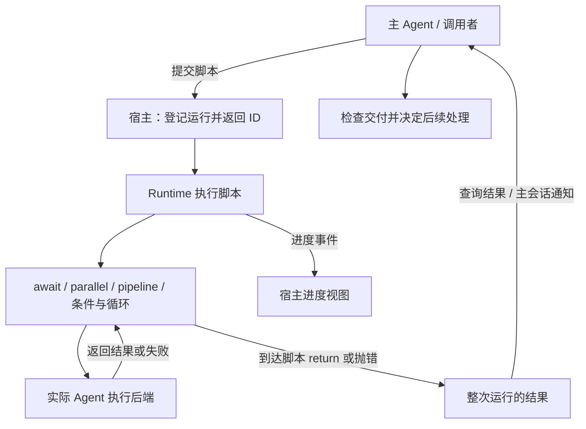

## 结论

这两个项目值得借鉴的是两部分能力：**让 Runtime 按明确规则推进工作，以及把真实结果交回主 Agent 继续判断。** 对 Vibe Studio，建议保留现有画布、Rust Runtime、文件交接和智能体适配器，补齐两部分之间的接力。

两者的核心引擎有共同来源，都是用 JavaScript 程序组织 Agent 调用。它们没有直接提供我们需要的整套“用户画图、文件交接、异常协调、进程恢复”的产品闭环。

- **DynaFlow** 更值得学习结果回收与交付检查：主 Agent 发起执行、读取真实返回值、检查后再回答；不能把“已启动”当成“已交付”。
- **claude-code-best 的 workflow-engine** 更值得学习工程分层：引擎通过接口接入实际执行、进度事件、后台任务、停止和持久化，宿主再把结果送入主会话。
- **Vibe Studio 已有自己的基础**：固定工作流、文件身份和哈希校验、拆分分工与批次汇总。下一步应明确流转语义与主 Agent 介入点，再改善展示。

第二个项目属于第三方 `claude-code-best/claude-code`，不是 Anthropic 官方 Claude Code。本分析不把其功能视为官方 Claude Code 的承诺。

## 研究版本与验证范围

研究日期：2026-11-01。下面的结论对应本地源码快照。

| 项目             | 提交                                       | 主要入口                                                                                                                                                |
| ---------------- | ------------------------------------------ | ------------------------------------------------------------------------------------------------------------------------------------------------------- |
| DynaFlow         | `7451639d197ef844b4157cf40eadac68e9eba8ca` | [Python 宿主](./references/dynaflow/src/dynaflow/workflow.py)、[引擎](./references/dynaflow/workflow_runtime/src/engine/runWorkflow.ts)                 |
| claude-code-best | `8d80e740f764be358e265eed4250606c78fca579` | [独立引擎包](./references/claude-code/packages/workflow-engine/src/engine/runWorkflow.ts)、[宿主服务](./references/claude-code/src/workflow/service.ts) |

本次沿调用链阅读源码，并核对参考引擎已有测试的断言；未安装参考项目依赖、启动 Docker、运行模型请求或执行其测试。下文的分支风险属于源码分析结论，不是已复现的运行记录。本文只形成研究与建议，不修改产品行为。

本地 `references/` 被忽略。其他机器复核时，可按上述提交获取源码；也可阅读固定版本的 [DynaFlow 宿主](https://github.com/amiya-special/Dynaflow/blob/7451639d197ef844b4157cf40eadac68e9eba8ca/src/dynaflow/workflow.py)和 [claude-code-best 引擎](https://github.com/claude-code-best/claude-code/blob/8d80e740f764be358e265eed4250606c78fca579/packages/workflow-engine/src/engine/hooks.ts)。项目来源和许可关系见[研究入口](./README.mdx)。

## 谁决定流程，谁真正执行

两个项目的控制关系大致如下。图中的主 Agent 回收点是**整次脚本运行的结果**；不会因为每个子 Agent 结束，就自动打断脚本并调用主 Agent。

**主 Agent 决定怎么组织工作，Runtime 执行这份组织安排。** 子 Agent 不会自行寻找下一个节点，也不自动与相邻 Agent 建立聊天通道。它们通过脚本显式传入的材料和返回值衔接。

两者都允许脚本使用分支与循环，但这不等于引擎自动理解业务。比如“缺少证据就重新核查”，必须由脚本或拿到结果的主 Agent 明确作出判断。

## 核心流转能力对照

| 能力       | DynaFlow                                | claude-code-best                               | 对我们的意义                             |
| ---------- | --------------------------------------- | ---------------------------------------------- | ---------------------------------------- |
| 编排表示   | 主 Agent 提交内联 JavaScript            | 内联脚本、脚本文件、命名脚本                   | 借鉴执行语义，继续使用用户创建的工作流图 |
| 串行       | `await` 前一步后再发起下一步            | 相同                                           | 串行必须以实际完成为依据                 |
| 并行后汇总 | `parallel` 等所有分支返回               | 相同                                           | 等齐之后还要检查哪些分支成功             |
| 逐项流水线 | 每项独立经过多个 stage                  | 相同                                           | 与“整批做完阶段一再进入阶段二”不同       |
| 分支与循环 | 普通 JavaScript 控制流                  | 相同                                           | 条件决定可以来自 Agent，执行仍归 Runtime |
| 阶段展示   | `phase` 产生展示事件                    | 相同，另有阶段视图计算                         | 阶段标题不是调度屏障                     |
| 子调用交付 | 非空、可序列化检查，可选 JSON Schema    | 可选 JSON Schema，并校验缓存的结构化结果       | 文件是否可用仍需我们的 Runtime 检查      |
| 最终交付   | 区分脚本执行完成与结果有效              | 脚本正常返回即标记 completed                   | 不能用进程退出或空回复判定业务成功       |
| 执行后端   | Python 宿主通过模型 API 和研究工具执行  | 具备后端注册接口，当前宿主只注册 claude-code   | 接口可借鉴，不能当成已实现多家 CLI 接入  |
| 停止       | Python 取消标记、请求中断和容器清理     | 运行级信号、Agent 级控制器、实际后端中断       | 必须区分停止一个执行和停止整个工作流     |
| 恢复       | 日志重放；当前 Session 内恢复已结束运行 | 日志重放、终态快照和历史读取                   | 两者都不等于服务重启后自动恢复真实进程   |
| 过程观察   | 事件文件、主会话记录、结果和尝试记录    | 事件总线、状态 Store、终端进度面板、主会话通知 | 学事件与事实的关系，界面复用现有会话     |

主要证据：[DynaFlow hooks](./references/dynaflow/workflow_runtime/src/engine/hooks.ts)、[参考引擎 hooks](./references/claude-code/packages/workflow-engine/src/engine/hooks.ts)、[后端注册](./references/claude-code/src/workflow/registry.ts)、[进度 Store](./references/claude-code/src/workflow/progress/store.ts)。

### 并行与流水线必须分清

假设有三份材料，每份都需要“分析 → 核查”。

- **整批阶段推进**：三份全部分析完，才开始核查。
- **逐项流水线**：第一份分析完就可以开始核查，第二份和第三份仍在分析。
- **并行后汇总**：各自完成全部工作，再把所有成果交给共同的汇总步骤。

两个参考引擎的 `pipeline` 实现第二种，`parallel` 后接共享步骤实现第三种。Vibe Studio 当前拆分批次采用“阶段间串行、阶段内并行”，属于第一种规则。它们适合的业务不同，不能只在 UI 上都标成“并行”后混用。

还有一个容易误判的细节：`agent()` 失败通常返回 `null`；`pipeline` 只有遇到**抛出的异常**才会跳过该项后续阶段，收到 `null` 本身并不会停止。因此，前一步没有成果时，脚本仍可能启动下一步。

`phase()` 则只改变进度分组，不会等待这个阶段的所有 Agent。并行分支使用共享的当前阶段还可能产生归组混淆，因此上游提示也建议在并行调用中显式传入阶段。

## DynaFlow：把真实交付带回主 Agent

### 主子协调实际怎么发生

[Session.run](./references/dynaflow/src/dynaflow/workflow.py) 给主 Agent 提供 `Workflow`、`TaskOutput`、`TaskStop` 三类工具。

1. `Workflow` 启动后台引擎，立即返回运行 ID。
2. 主 Agent 用 `TaskOutput` 等待或查询真实结果，结果作为工具回复进入主会话。
3. 如果主 Agent 提前给出最终回答，而仍有未读取的运行，宿主会等待这些结果、把完成通知加入会话，然后继续调用主 Agent。提前生成的回答不会直接成为最终交付。
4. 主 Agent 在新一轮中判断结果是否够用，再总结或调整后续工作。

在已尝试工作流的情况下，宿主还要求至少存在有效运行回执和成功的配置模型子调用，才接受最终回答。这个检查约束“回答确实经过执行”，不证明答案正确或所有必要分工已经完成。

这里值得借鉴的是**结果接收后再作判断的闭环**。其原本允许主 Agent 生成或修改脚本的入口，不符合我们已确认的边界；Vibe Studio 的主 Agent 只在用户已创建的工作流内作决定。

### 执行结束与交付成功分开

[runWorkflow](./references/dynaflow/workflow_runtime/src/engine/runWorkflow.ts) 和 [deliveryValidation](./references/dynaflow/workflow_runtime/src/engine/deliveryValidation.ts) 分别记录执行状态与交付有效性：脚本能正常结束，但返回值为空或不符合约定，整体仍判失败。

无 Schema 时，检查主要是“可序列化且存在非空内容”；配置 Schema 时按 Schema 检查。这不是业务验收。例如并行结果中 A 有内容、B 为 `null`，整体返回对象仍可能通过默认内容检查。要保证完整交付，必须明确要求 B 的成果，不能只检查对象非空。

### 执行环境与我们的差异

其 Python 宿主负责模型 API、研究工具调用和取消；JavaScript 引擎放在无网络容器中运行，通过标准输入输出请求宿主执行子 Agent。它并不是把我们支持的各家原生 Agent CLI 直接嵌进去。

日志、脚本和回执落盘有助于审计，但业务交接仍以提示词和返回对象为主。源码没有提供与我们现有“项目文件绑定到具体执行、内容哈希核对”相同的交接契约。

## claude-code-best：引擎与宿主的工程边界

### 引擎只处理编排，宿主接上真实能力

[WorkflowPorts](./references/claude-code/packages/workflow-engine/src/ports.ts) 将实际执行、进度发布、任务登记、日志存储等能力隔离到接口；[AgentAdapter](./references/claude-code/packages/workflow-engine/src/agentAdapter.ts) 提供后端选择、取消与进度回调。

实际宿主的 [registry](./references/claude-code/src/workflow/registry.ts) 只注册一个 claude-code 后端。[该后端](./references/claude-code/src/workflow/backends/claudeCodeBackend.ts)调用项目内部的 `runAgent`，接入工具与权限，并支持独立 worktree。它不是已经封装好 Codex、Gemini 等原生 CLI 的通用执行器。

适合我们借鉴的是这个边界：工作流 Runtime 不需要理解每家协议，实际启动、取消、流式事件和原生会话继续由现有智能体底座提供。

### 完成通知确实能进入主会话，但依赖宿主

这条链在源码中可以串起来：

1. 引擎发布 `run_done`，进度 Store 更新运行状态。
2. [notifications](./references/claude-code/src/workflow/notifications.ts) 识别进入 completed、failed、killed 的变化，加入主会话通知队列。
3. [队列处理 Hook](./references/claude-code/src/hooks/useQueueProcessor.ts) 在主查询空闲、没有阻塞界面时，通过宿主输入执行路径消费通知。用户输入的默认优先级高于此类通知。
4. 主 Agent 获得通知后可以查询和处理结果。通知本身主要包含运行标识、状态和错误摘要，不等于完整交付材料。

因此，它不只是显示一个提示；**完整宿主有继续主会话的路径**。但独立引擎包只有事件接口，单独复制引擎不会自动获得队列、主会话唤醒或结果检查。通知订阅用内存状态避免同一终态重复通知，也不等于跨重启的可靠投递。

## 失败、停止与恢复的真实边界

### 失败不是统一的“重试一次就好了”

| 情况                               | 源码行为                                                         | 需要注意                                     |
| ---------------------------------- | ---------------------------------------------------------------- | -------------------------------------------- |
| 参考引擎后端返回 dead 或抛普通错误 | 最多补试一次；仍失败则对脚本返回 `null`                          | 普通失败未必让整次工作流失败                 |
| 参考引擎结构化输出不合格           | 转为 dead，也会进入补试                                          | 是否允许再次执行有副作用的任务，需要宿主决定 |
| DynaFlow 交付无效、不完整或不匹配  | 这些 dead 原因不走通常的自动补试                                 | 交给脚本或主 Agent 判断下一步                |
| DynaFlow 其他失败                  | 通常补试；首轮 dead、第二次抛错时还可能落入外层 catch 再调用一次 | 源码分支不保证严格只有两次后端调用           |
| 日志命中失败结果                   | 返回已记录的失败，即 `null`                                      | “恢复”不会自动重跑失败调用                   |
| Agent 返回失败后脚本仍正常 return  | 参考引擎可把整次运行标记 completed                               | 必须额外检查必需成果                         |

DynaFlow 保留 `attempts` 与交付诊断，便于区分多次尝试。参考引擎也保留最终失败原因，但当前宿主的 `pendingAction()` 始终返回 `null`，不能把接口中预留的 skip/retry 当作已接通的交互能力。

### 取消信号要一直传到真正执行者

参考引擎的运行级信号，经宿主注册表和后端桥接到实际 Agent 的取消控制器；其 `parallel`、`pipeline` 会继续抛出工作流取消异常，避免把用户停止吞成普通空结果。已有[引擎测试](./references/claude-code/packages/workflow-engine/src/__tests__/runWorkflow.test.ts)明确检查取消后状态应为 killed。

但该版本仍有一个需要验证的分层矛盾：服务注释称“停止单个 Agent 不影响工作流”，实际后端却可能把这个 Agent 的中断也抛为 `WorkflowAbortedError`，引擎再把整次运行判为 killed。注册表只中断一个控制器，并不能证明最终运行状态也保持局部取消。这个风险来自调用链推导，尚未做端到端验证。

DynaFlow 的核心 `parallel`、`pipeline` 则会捕获所有异常，包括取消异常。不能直接据此断言其产品停止失效：Python 宿主另有取消标记、请求中断、容器终止和结果映射。可借鉴其完整清理路径，但不能抽出核心引擎后假设取消语义仍然完整。

### 日志重放不是进程恢复

两者都用 `journal.jsonl` 记录 Agent 调用，通过提示词和参数生成的键匹配缓存，按调用序号恢复顺序。它有助于跳过已经记录的相同工作，但有以下限制：

- 成功与失败都会被重放。一次失败不会因为点“恢复”就自动变成新的尝试。
- 匹配依赖调用顺序；并行中断后只留下部分结果，不保证每个已完成分支都能独立复用。
- 引擎提供 `scriptChanged` 失效开关，但必须由宿主设置。DynaFlow 的 Session 会比较脚本文本；参考项目已检查的工具和服务入口只传 `resume`，没有传这个开关，不能承诺其入口会自动识别所有脚本改动。
- 缓存键没有证明项目文件未变，也没有解决“Agent 已写文件，但结果还没记入日志就宕机”的窗口。
- 恢复时没有仅靠日志便可获得的“旧 CLI 进程是否仍在运行”的事实，不能保证外部操作只执行一次。

参考项目的 [persistence](./references/claude-code/src/workflow/persistence.ts) 主要在 `run_done` 后保存终态快照；缺失快照的目录不会变成自动恢复的运行。DynaFlow 的恢复入口要求旧运行仍存在于当前 Session 的内存 jobs 中，而且已经结束。它们都不是完整的跨服务重启调度协议。

还有一个不宜照搬的存储细节：参考引擎清空日志时会删除整个运行目录，该目录也用于存脚本和状态；DynaFlow 改为只删日志文件。复用成功成果与更新缓存时，应保留独立的运行、文件和尝试身份。

## 对照 Vibe Studio：真正需要补齐什么

### 当前已有能力

| 已有基础           | 源码事实                                                                                                                                                  |
| ------------------ | --------------------------------------------------------------------------------------------------------------------------------------------------------- |
| 图驱动执行         | [planner.rs](../../../crates/workflow/src/planner.rs) 计算可执行节点，[runner.rs](../../../crates/server/src/workflow_runtime/runner.rs) 依据真实执行推进 |
| 固定范围的拆分分工 | [dispatch.rs](../../../crates/workflow/src/dispatch.rs) 校验候选执行节点、阶段和完整分配；拆分项属于工作流内部                                            |
| 批次依赖与汇总     | [batch_runtime.rs](../../../crates/server/src/workflow_runtime/batch_runtime.rs) 记录子项执行；成功的并行分支保留，失败阻止正常后续阶段与完整汇总         |
| 文件交接           | [file_handoff.rs](../../../crates/server/src/workflow_runtime/file_handoff.rs) 校验交接所属执行、实际文件和内容哈希；不以聊天文本替代缺失文件             |
| 主 Agent 管理入口  | [management.rs](../../../crates/server/src/workflow_runtime/management.rs) 受理有范围的操作，并校验文件与请求身份                                         |
| 自动主 Agent 分工  | [handover.rs](../../../crates/server/src/workflow_runtime/handover.rs) 对已受理拆分建立持久接力事件                                                       |

这些能力应继续作为底座。本轮没有发现必须换成 JavaScript 引擎才能解决流转的依据。

### 两个需要先讲清楚的缺口

**第一，普通多入边与拆分汇总不是同一种触发规则。**

普通节点的 `execution_is_ready` 使用 `.any(...)`：任一入边已有成功触发就可以运行；现有测试也明确允许 A 成功、B 未完成时 join 已可执行。普通图还会据触发情况创建后续执行轮次，因此不能把这个行为描述成默认的“等齐再汇总”。

这描述的是规划层规则。[runner.rs](../../../crates/server/src/workflow_runtime/runner.rs) 还会聚合真实 Agent 的终态，但 `reconcile_workflow_run_with_arena_and_boundary` 会继续调用 `drive_workflow_run`，后者使用规划结果驱动就绪节点。不能仅凭 `.any` 或 `all_active_agent_runs_terminal` 中的任意一个变量，声称已经端到端验证了普通汇合行为；本轮仍为源码对照，没有运行真实多分支测试。

拆分批次另有完整汇总判断。下一轮设计需要明确哪些连接是“任一路径到达就继续”，哪些汇总是“所需成果齐全才继续”。不能直接把所有 `.any` 改成 `.all`，否则条件分支只走一路时也可能永远等不齐。

后续已确认的[串行、并行与汇合规则](./file-handoff-design.mdx#已确认的串行并行与汇合规则)要求：并行汇总等待本轮全部所需交付，条件分支只等待实际选择的路径，并把触发和复用绑定到准确执行。这部分产品调度调整尚未实施。

**第二，已有主 Agent 不代表普通结果和异常已经自动交给它。**

当前 `handover.rs` 明确限定：自动启动主 Agent 的场景只有已受理拆分后的分工接力。通知、读取和普通节点完成不会走此路径。Runtime 对必要执行失败已有失败收口和成功成果保留，但不等于主 Agent 会自动接收异常并决定修复。

适合补充的是有明确来源的结果接收与异常接力：记录哪个执行发生什么、哪些交付可用、阻塞哪些后续工作，再把对应材料交给当前工作流主会话处理。

## 用一个场景验明流转

用户已经画好：A 分析需求，B 核对风险，两者并行；C 读取两份文件，完成最终交付。

| 时刻            | 参考源码告诉我们的事                                        | 建议 Vibe Studio 呈现的行为                                               |
| --------------- | ----------------------------------------------------------- | ------------------------------------------------------------------------- |
| A、B 启动       | 并发执行与汇总等待是两件事                                  | 用户能看到谁在执行，C 说明等待哪些成果                                    |
| A 完成，B 失败  | `parallel` 会收回成功结果和空失败值；没有业务判断便可能继续 | 保留 A 的已验证文件；C 不把 B 的缺失当作成功输入                          |
| 需要处理 B      | DynaFlow 会将整次结果交回主 Agent；参考项目通过宿主通知接力 | 对当前工作流生成一次可追踪的异常接力，向主 Agent 提供错误与文件           |
| 主 Agent 作决定 | 推理本身不会启动新进程                                      | 通过已有管理入口提交允许范围内的重试、返工或等待用户决定，由 Runtime 受理 |
| B 新尝试成功    | 日志命中与真实重新执行必须区分                              | 校验新交付及其执行身份，准确复用 A；按已受理方案启动 C                    |
| 用户点击停止    | 局部取消和整体停止不能共用含糊语义                          | 停止当前工作流的执行与待处理接力；旧通知不能又启动任务                    |

右列是下一轮设计建议，不代表以上场景已全部实现。重试究竟落到哪个现有 Run/尝试对象，需沿用管理层的真实受理模型，不靠改一个失败状态来伪装恢复。

## 后续讨论中已确认的文件交接设计

[文件交接与目录设计](./file-handoff-design.mdx) 记录本轮后续确认：工作流控制文件集中到项目内的 `.vibe-studio`，并按工作流定义、运行和节点执行逐层区分；节点启动时由 Runtime 自动注入交付要求。当前源码仍使用原路径，本文对现有能力的描述不等于新目录已实施。

异常处理已进一步收敛：执行失败或交付不合格时，都把真实现场交给主 Agent 判断，由它决定补交、继续工作、重做或询问用户，Runtime 受理执行。程序区分失败事实，但不把“某种错误必定执行某种补救”写成固定分支。保留其他分支的成功成果，下游等待必要交付验收通过。这些是已确认的设计方向，普通异常的自动主 Agent 接力和针对性补交尚未实施。

主 Agent 决定与 Runtime 受理的职责也已确认：错误材料进入原主会话，具体工作说明通过文件交接，处理决定使用现有管理工具提交并返回受理、等待或拒绝结果。正常成功流转不增加主 Agent 必经调用。画布和会话中的新增展示仍以设计页中标明的交互建议继续讨论。

## 建议的优化顺序

| 优先级 | 设计内容                               | 完成标准                                                                 |
| ------ | -------------------------------------- | ------------------------------------------------------------------------ |
| P0     | 明确分支到达、等齐汇总、阶段等待的规则 | 用户画出的连接含义与实际调度一致；不能因缺文件提前继续                   |
| P0     | 普通失败与需检查结果的主 Agent 接力    | 材料真实、事件持久、有来源；主会话忙时能等待，同一事实不重复启动         |
| P0     | 主 Agent 决定与 Runtime 受理闭环       | 决定限定在既有工作流范围；可看到是否受理、启动、完成或被停止             |
| P0     | 停止与重复执行约束                     | 沿用现有取消和执行身份，用户停止后不再自动推进，同一通知或请求不重复启动 |
| P0     | 对应的用户可见反馈                     | 在现有画布与会话说明“谁在执行、为何等待、谁在处理、成果在哪”             |
| P1     | 逐项流水线                             | 有实际吞吐需求后，再区别于现有整批阶段模式引入                           |
| P1     | 更丰富的统计与调度策略                 | 以可用的真实运行数据支撑，不先增加一套复杂面板                           |

跨服务重启后自动接管运行中的 CLI，是我们额外提出的增强，两个参考项目没有完整提供；本轮已决定后放，不把它作为当前流转闭环的前置条件。

这里的优先级是研究建议。后续实施仍以你确认的具体设计为准，保持这些边界：用户创建工作流、运行后定义不随意改动；普通任务与单 Agent 不构造工作流；子项不进入业务任务列表；成果走文件；聊天继续复用现有窗口。
