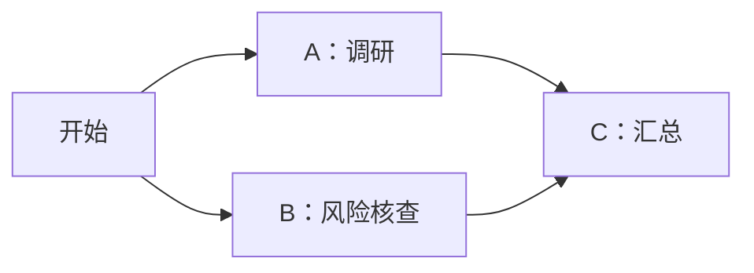
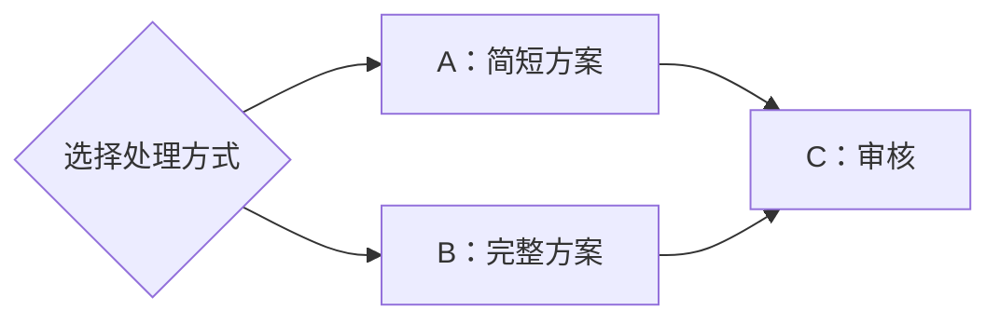

## 设计状态

本页记录本轮讨论中已确认的文件交接设计和异常处理原则。第一版已接入新目录、依赖汇合、异常接力及现有会话界面，检查结果和验证边界见[实施文档](./implementation.mdx)。[引擎分析](./engine-analysis.mdx)保留改造前的研究快照和参考来源。

你创建工作流并配置节点。系统启动节点时，自动告诉 Agent 要读哪些文件、把交付清单写到哪里。Agent 正常聊天和调用工具，成果写入文件；Runtime 等本轮真实执行结束，再验收文件、推进下游。

本轮收敛为两条主线：正常执行按画布和文件交付自动推进；执行或交付出现异常，把真实现场交给主 Agent 判断，再由 Runtime 执行它提交的决定。程序检查执行状态、文件和依赖，异常后的业务处理不预设成固定的错误分支表。

## 已确认的目录

按“项目 → 工作流定义 → 某次运行 → 节点执行”组织文件。工作流控制文件集中放在项目内的 `.vibe-studio` 目录。

以下尖括号表示系统生成的稳定编号。

```text
项目目录/
├─ .vibe-studio/
│  └─ workflows/
│     └─ <工作流ID>/
│        └─ runs/
│           ├─ <第一次运行ID>/
│           │  ├─ request.md
│           │  ├─ handoffs/
│           │  │  ├─ <执行A编号>.json
│           │  │  └─ <执行B编号>.json
│           │  └─ results/
│           │     ├─ <执行A编号>.md
│           │     └─ <执行B编号>.md
│           └─ <第二次运行ID>/
│              └─ ...
└─ reports/
   └─ 调研报告.md
```

| 文件或编号                   | 含义                                                   |
| ---------------------------- | ------------------------------------------------------ |
| 工作流 ID                    | 用户创建的工作流定义；多次运行归到同一个工作流目录     |
| 运行 ID                      | 工作流的某一次运行；再次运行建立独立目录               |
| 节点执行 ID                  | 节点的一次实际执行；重试使用新的执行编号，保留之前交付 |
| `request.md`                 | 本次运行已受理的需求，由 Runtime 写入                  |
| `handoffs/<节点执行ID>.json` | 该次执行的交付清单，由 Agent 按系统要求写入            |
| `results/<节点执行ID>.md`    | 交接说明：完成了什么、限制和下游注意事项               |
| `reports/调研报告.md`        | 业务成果示例；实际成果按任务需要放置，由清单引用       |

目录使用稳定 ID，工作流或节点改名不改变目录。多个节点的清单独立存放；清单不能只按节点名称或节点定义 ID 命名，因为同一节点可能多次执行。

这一层归组用于保留和查找历史。不同运行能否同时修改同一项目，由调度规则决定，不能因为有不同运行目录就视为可以安全并发。

## 节点怎样知道要写文件

Runtime 在每次启动节点时，向实际 Agent 请求追加交付指令。用户无需手写清单，也无需给每个节点重复配置这套规则。

例如启动调研节点时，系统自动提供以下内容；其中路径和执行编号由系统填好。

```text
读取本次运行的 request.md 和指定的上游成果。
完成这个节点的调研工作，把成果保存为文件。
把交接说明写入你这一次执行的 results 文件。
最后把成果文件和交接说明的位置写入你这一次执行的 handoffs 文件。
使用系统提供的运行编号和执行编号；结束前完整发布交付清单。
```

节点职责和具体输入仍来自用户已配置的工作流。系统追加的部分只规定输入来源和交付方式。

聊天、思考、工具调用和中间说明不要求采用 JSON。交付清单只是单独的一份小文件。普通单智能体会话不因此获得创建或拼装工作流的入口。

## 清单记录什么

沿用现有交付协议的五个字段：

| 字段                | 用途                       |
| ------------------- | -------------------------- |
| `schema_version`    | 交付清单格式版本           |
| `run_id`            | 清单所属的这一次工作流运行 |
| `node_execution_id` | 清单所属的这一次节点执行   |
| `summary_path`      | 交接说明的位置             |
| `artifact_paths`    | 其他实际成果文件的位置     |

工作流定义 ID 来自 Runtime 已绑定的运行关系，并用于生成目录；无需再让 Agent 在清单内重复维护它。清单中的文件路径相对于本次运行绑定的实际工作目录。

Agent 写成果和交接说明，最后完整发布清单。Runtime 计算文件哈希并记录真实执行状态；Agent 不在清单里自行声明“已经成功”，也不直接改运行状态。

## 怎样进入下一个节点

1. Runtime 启动上游节点，传入该次执行专属的输入和交付路径。
2. Agent 正常执行，写成果、交接说明和交付清单。
3. 智能体适配层接收原生成功结束事件。这里等待的是本轮执行结束，常驻 CLI 或 app-server 进程可以继续保留。
4. Runtime 检查清单格式、版本、执行归属和实际文件，计算哈希并记录验收结果。
5. 验收通过且满足画布的依赖条件后，Runtime 才启动下游，把准确的上游清单及成果文件路径交给它。

文件出现、聊天中说“完成了”，都不能单独触发下一步。等待用户输入、等待权限、失败和取消，分别沿用真实执行状态处理。

缺少清单、编号不匹配或成果文件不可读时，上游不能作为成功交付推动下游。文件格式和可读性检查不能证明业务质量；内容是否合格由明确配置的审核节点或主 Agent 处理。

## 并行写文件的边界

不同节点的清单和交接说明按执行编号隔离。业务文件仍由 Agent 在实际工作目录内操作，目录分组不会自动给同一个业务文件加锁。

并行节点应分别输出自己的成果，由后续节点汇总；需要修改同一个文件的节点应顺序执行。共享目录和 worktree 两种模式都需要保证 Agent 收到的路径与 Runtime 验收的实际文件一致。

现有实现会核对已受理文件的内容哈希。需要供后续多个节点反复读取的成果，应保留对应版本；后续节点修改工作文件时，不能让旧交付清单悄悄指向新内容。

## 与改造前实现的区别

改造前 [file_handoff.rs](../../../crates/server/src/workflow_runtime/file_handoff.rs) 使用 `.vibe-kanban/workflows/<运行ID>/...`，已具备交付指令、文件验收、哈希绑定和下游引用。

本轮统一调整为 `.vibe-studio/workflows/<工作流ID>/runs/<运行ID>/...`，新的节点尝试保留各自交付。路径生成、指令、文件读取、交付物展示和实际重试身份共同使用这一规则，文件根目录与 Agent 的实际工作目录一致。

本页只确定工作流文件的新路径。既有项目身份文件、业务任务存储及其他 `.vibe-kanban` 操作标识的调整，不在这次目录讨论中扩展。

## 已确认的异常处理

以 A、B 并行执行、C 需要两者成果为例，采用以下规则：

| 情况                               | 处理方式                                                    | C 的状态               |
| ---------------------------------- | ----------------------------------------------------------- | ---------------------- |
| A 已成功，B 还在执行               | 保留 A 的已验收成果，继续等待 B                             | 等待 B                 |
| B 执行失败，或交付清单、成果不合格 | 记录具体错误、已有文件和验收情况，交给主 Agent 判断如何处理 | 等待合格交付或用户决定 |
| B 的新交付通过验收                 | 复核并复用 A 的已验收成果，向 C 提供 A、B 的准确交付来源    | 满足依赖后执行         |

Runtime 区分执行失败和交付不合格，用于提供准确现场。如何处理由主 Agent 判断；例如发现成果已齐全但缺少清单，可以安排原节点补交，发现实际工作没完成则安排继续工作、重新执行或询问用户。

### 补交是可选的处理方式

主 Agent 决定只补交时，目的在于修复交付手续，例如补上清单、修正执行编号或引用真实成果。补交指令应明确已有成果、验收错误和新的准确交付位置，避免让 Agent 从头执行整个节点任务。

补交继续使用原节点的会话上下文，按新的执行编号记录这一次处理，并关联之前的执行。原失败记录和已有文件保留；新交付仍须经过正常验收，不能把旧失败直接改成成功。

Agent 声称完成不等于成果已经存在。缺少实际成果文件时，程序不能自行认定“只补一张清单就够了”。未验收的文件也不能直接作为 C 的成功输入。

### 主 Agent 根据现场决定

主 Agent 获取真实错误、已有成果及其验收状态、被阻塞的后续节点，再判断重新执行、调整工作说明或向用户询问。处理决定限定于已有工作流和执行范围，调整工作说明不等于修改已经启动的工作流定义。

主 Agent 作判断，Runtime 负责受理和真正执行。主 Agent 不能通过修改文件或数据库把节点直接标记为成功。C 等到所需的新交付验收通过后才继续。

处理 B 时保留 A 的成功成果。复用时核对文件与源执行，文件已变化或不可读时明确报告，不能继续宣称原交付有效。

用户停止与执行失败分开处理。用户已停止工作流时，旧异常通知或未处理决定不能重新启动节点。

## 已确认的主 Agent 决定与 Runtime 受理

1. 程序把节点的真实错误、已有文件及验收状态、被阻塞的下游交给当前工作流的原主会话。
2. 主 Agent 读取这些材料，判断补交、重做还是询问用户。具体工作说明放在项目文件里，通过现有工作流管理工具提交处理决定。
3. Runtime 校验决定所属的工作流和源执行，返回已受理、等待或拒绝，以及对应原因。
4. 已受理的操作由 Runtime 安排执行；新的成果仍须验收，满足依赖后继续下游。

正常成功的节点继续由 Runtime 自动接力。主 Agent 处理需要判断的情况，不成为每个正常节点之间必经的一轮调用。

“主 Agent 建议重试”“Runtime 已受理”和“节点已经重新执行成功”是不同事实。会话中的解释和画布上的状态应跟随实际受理、启动和验收结果。

文件承载错误材料、工作说明和成果；管理工具用于提交操作、查询真实进展。单独写出处理说明文件不会触发执行。

### 复用现有管理通道

现有 [workflow_mcp.rs](../../../crates/executors/src/workflow_mcp.rs) 已定义 `workflow_get`、`workflow_submit`、`workflow_dispatch`、`workflow_stop` 和 `workflow_respond` 等工具，由[管理路由](../../../crates/server/src/routes/workflow_management.rs)连接 Runtime。本轮沿用这条管理通道，具体工作说明和成果继续通过文件交接。

本轮保持 [management.rs](../../../crates/server/src/workflow_runtime/management.rs) 的 `start`、`retry`、`rework` 三个提交动作，为 `retry`、`rework` 增加可选 `instruction_path`。异常接手的主 Agent 先写项目相对路径下的 UTF-8 说明文件，再提交准确的源运行和源节点执行编号。Runtime 在受理前读取文件并固化路径、哈希和正文；排队后修改文件不会改变已经受理的工作。重复请求返回原受理结果，不因之后删除说明文件而重新执行。

自动接手复用 [handover.rs](../../../crates/server/src/workflow_runtime/handover.rs) 的持久队列，每次失败执行最多记录一个异常事件，并将现场材料写入本次运行的 `exceptions/`。原主会话收到真实 System 消息，处理说明可写入 `instructions/`。它只能处理该异常对应的源运行和失败节点；已受理拆分的分工权限保持独立。新的处理仍失败时，将新事实交回原主 Agent 判断，沿用同一个闭环。

## 已确认的串行、并行与汇合规则

本节的依赖语义由调度规划器和文件读取共同执行。用户继续用节点和连线表达流程，Runtime 根据本轮实际路径判断需要哪些交付，无需额外放置同步节点。

### 串行：上一步交付通过后再继续

“调研 → 撰写 → 审核”依次执行。调研结束且成果验收通过，才启动撰写；撰写也通过后，再启动审核。

节点清单记录交付文件。下一个节点由 Runtime 根据画布决定，Agent 无需在清单中填写下游节点或自行启动下游。

### 并行后汇总：等齐这一轮所需成果



A、B 可以同时执行。C 需要两份成果，只有两者都验收通过才启动同一轮汇总，并且只启动一次。

A 先完成时保留它的成果，C 显示等待 B。B 需要补交或重试时，继续等待 B 的有效交付；复用 A 时核对原文件和来源，不要求 A 跟着重做。

### 条件分支：只等本次实际走的路



例如本次只选择 A，C 等 A 的交付，不等待未选中的 B。如果该条件允许同时选择 A、B，并且本次实际选了两者，C 就需要等齐两份成果。

在条件还没有作出决定时，不能提前把某条路径视为已跳过。明确跳过和执行失败也不同：跳过的路径不提供成果，失败的必要路径阻塞下游并进入异常处理。

某个节点本轮没有任何应到达的输入时，不因为“没有需要等的节点”而自行启动。等待还是跳过，应由实际选路和执行记录决定。

### 依赖必须绑定到准确的一次执行

Runtime 需要明确本轮 C 所需的上游执行，以及哪些路径已选中、已跳过或仍未决定。收到重复完成事件时，仍是同一轮 C；新的工作流运行或明确的新一轮处理，才产生对应的新执行。

旧运行的成功成果只有经过明确复用并通过文件核对，才能成为新执行的输入。不能只看到“节点 A 曾经成功过”，就把它算作本轮 A 已交付。

这一规则应由 Runtime 的画布、分支决定和执行关联记录保证。用户和 Agent 不需要在交付清单中手工维护依赖关系。

### 调度与读取使用同一组输入

本轮 [planner.rs](../../../crates/workflow/src/planner.rs) 将普通节点的任一成功入边触发改为等待本轮全部有效输入，并输出准确的来源执行轮次。拆分批次继续由 [batch_runtime.rs](../../../crates/server/src/workflow_runtime/batch_runtime.rs) 管理阶段和汇总。

[runner.rs](../../../crates/server/src/workflow_runtime/runner.rs) 聚合真实 Agent 终态并驱动规划；普通 Agent、条件、转换和结束节点读取文件时，都使用规划器选出的准确来源，避免把旧轮次的成功混入本次输入。

等待、明确选路排除和失败造成的跳过分别处理：未知路径继续等待，明确未选中的路径不参与汇合，失败的必要路径仍阻塞下游。重复完成观察不能再次启动已经消费过同一组输入的节点。

## 本轮保留的基本运行约束

- 收起浮框、离开画布或关闭浏览器，后端仍在运行时继续执行；重新打开页面读取原运行和会话，不重复发送任务。
- 用户停止后停止发起后续工作，并取消本次工作流相关执行。按真实停止结果更新界面，保留历史和成果；旧通知不能把已停止运行重新启动。
- 主会话忙碌时暂存异常，空闲后接力。同一异常和重复提交沿用已有事件、请求身份合并处理，避免重复启动；新的重试及新错误按各自身份记录。

这些约束沿用现有执行、会话与管理能力。异常怎样补救继续由主 Agent 根据现场决定，本轮不新增一套通用恢复平台或多级固定错误处理流程。

## 后放的增强：跨服务重启自动接管

跨服务重启后自动接管仍在运行的 CLI，移出本轮核心范围。保留现有状态读取和核对能力，无法确认原执行时如实呈现，交由用户或主 Agent 决定后续处理，避免盲目重复启动。

两个参考项目主要提供日志重放、结果读取或终态快照，没有完整提供这一接管机制。它属于我们额外提出的增强，不能作为“参考项目已经支持”的本轮前提。

## 第一版交互：画布与会话怎样展示

第一版继续沿用[现有画布和共享会话浮框](../multi-agent-workflow-ux/README.mdx)，补充简短协调提示、异常文件入口和原主会话导航。下面列出应表达的事实；已受理不显示成已启动，失败记录不会因等待主 Agent 而变成成功。打开尚未执行的节点只查看信息，不创建会话或启动 Agent。

| 实际情况                  | 画布上的信息                                                    | 点击后的内容                                                |
| ------------------------- | --------------------------------------------------------------- | ----------------------------------------------------------- |
| A 已验收，B 正常执行      | A 显示已有成功状态，B 显示执行中；C 说明等待 B                  | A 打开原会话和交付物，B 打开正在执行的原会话                |
| B 的补交已经启动          | B 显示本次正在补交；C 仍等待 B                                  | 打开 B 的同一个会话，查看补交指令、响应和验收结果           |
| B 失败，等待主 Agent 接手 | B 说明等待处理，C 说明等待 B；主 Agent 按真实状态显示等待或执行 | B 保留原错误；点击主 Agent 打开原主会话，查看原因和处理过程 |
| 主 Agent 需要用户决定     | 明确显示等待用户，不继续启动依赖此决定的执行                    | 在原主会话里阅读问题并回复                                  |
| B 新交付已验收，C 已启动  | B 显示本次成功，C 显示执行中                                    | 点击 C 查看它实际读取的交付物和同一个会话                   |

节点上的信息保持简短；具体错误、处理解释和成果通过会话及已有交付物折叠区查看。用户不需要手动填写 JSON 或寻找内部清单才能继续工作。

原失败执行和补交执行分别保留。节点可以突出最近一次真实处理，但不能删掉失败历史，也不能在尚未启动补交时显示“正在补交”。
